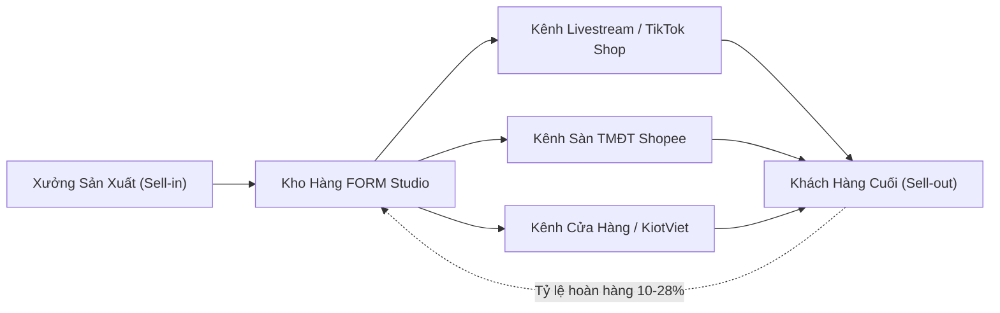
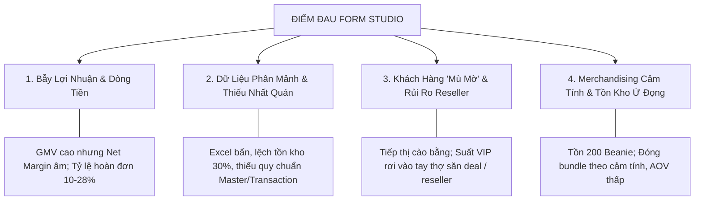
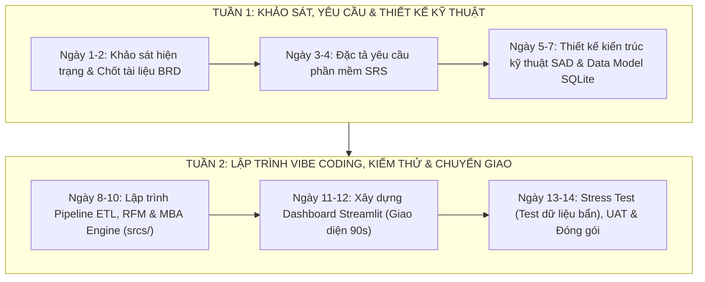

# BÁO CÁO KHẢO SÁT HIỆN TRẠNG & ĐIỂM ĐAU DOANH NGHIỆP
## Dự án: Hệ Thống Phân Tích Kinh Doanh & Trợ Lý Ra Quyết Định Thông Minh (Smart Fashion Dashboard)
**Khách hàng mục tiêu:** FORM Studio (Streetwear Local Brand - Hà Nội)  
**Chuyên gia tư vấn:** Strategic Business & Analytics Consultant  
**Đối tượng tham chiếu dự án:** Chương trình Đào tạo Nghiệp vụ BA & Vibe Coding  
**Thời gian lập:** Tháng 10/2026  

---

## 1. TỔNG QUAN DOANH NGHIỆP: FORM STUDIO

### 1.1. Hồ sơ thương hiệu
* **Tên thương hiệu:** FORM Studio
* **Lĩnh vực hoạt động:** Thời trang thiết kế đường phố (Streetwear / Unisex Local Brand) tại Hà Nội, phục vụ phân khúc giới trẻ (Gen Z, Hypebeast, cộng đồng yêu thích văn hóa đường phố).
* **Mô hình vận hành kinh doanh (Business Model):** 
  * Mô hình phát hành theo đợt (**Drop Model**): Sản xuất và mở bán giới hạn theo các chiến dịch cao điểm (Drop Xuân/Hè, Thu/Đông, Drop Tết) kết hợp flash sale (11.11, Black Friday).
  * Kênh phân phối đa kênh (**Omnichannel**): Bán hàng trực tuyến qua TikTok Shop (Livestream), Shopee, Instagram/Fanpage và hệ thống bán lẻ trực tiếp (POS/KiotViet).
* **Đại diện quản lý:** Founder kiêm Giám đốc Vận hành (**Anh Minh**).

---

## 2. HIỆN TRẠNG HOẠT ĐỘNG VÀ BỨC TRANH KINH DOANH

Qua quá trình phỏng vấn sâu Founder Minh và rà soát tài liệu thực tế của doanh nghiệp, bức tranh hoạt động của FORM Studio bộc lộ sự tương phản rõ rệt giữa **vẻ hào nhoáng trên truyền thông** và **sự mong manh về tài chính vận hành**:

### 2.1. Đỉnh cao truyền thông vs. Thực tế dòng tiền
* **Ảo ảnh "Sold-out":** Đợt Drop Tết vừa qua ghi nhận 500 chiếc áo hoodie bán sạch chỉ trong 6 giờ livestream trên TikTok Shop. Lượng tương tác bùng nổ, truyền thông đưa tin, tạo cảm giác thương hiệu tăng trưởng phi mã.
* **Nghịch lý 11 giờ đêm:** Ba tháng sau đợt bán hàng thành công rực rỡ, Founder Minh rơi vào khủng hoảng thanh khoản: không còn tiền mặt lưu động để thanh toán tiền vải và đặt cọc xưởng may cho bộ sưu tập kế tiếp.

$$\text{Doanh thu GMV (Gross)} \neq \text{Dòng tiền thực nhận (Cash flow)} \neq \text{Lợi nhuận ròng (Net Profit)}$$

### 2.2. Chi phí ẩn và độ trễ dòng tiền (Cash Flow Timing Lag)
Trong mô hình bán hàng qua sàn TMĐT (đặc biệt là TikTok Shop), dòng tiền bị chiết khấu và giam giữ qua nhiều khâu:
1. **Phí sàn & Thanh toán:** Phí giao dịch, phí nền tảng chiếm từ $5\% - 8\%$.
2. **Chi phí Tiếp thị & Hoa hồng KOC/KOL:** Hoa hồng tiếp thị liên kết (Affiliate) và booking KOC review dao động từ $15\% - 20\%$ doanh thu.
3. **Chi phí Vận hành & Đóng gói:** Hộp đóng gói chuyên dụng thời trang, quà tặng kèm, tem nhãn, phí hoàn hàng hai chiều.
4. **Độ trễ đối soát dòng tiền:** Tiền hàng từ sàn chỉ về tài khoản sau $7 - 14$ ngày kể từ khi đơn hàng giao thành công. Khi phát sinh hoàn trả, chu kỳ đối soát kéo dài đến 30 ngày.

---

## 3. CÁC ĐIỂM ĐAU CỐT LÕI CỦA FORM STUDIO (PAIN POINTS)

Dưới góc nhìn của nhà tư vấn quản trị, các vấn đề của FORM Studio được phân loại thành 4 nhóm điểm đau trọng yếu:

### 3.1. Điểm đau 1: Bẫy lợi nhuận ảo (GMV vs. Profit) và Tỷ lệ hoàn hàng
* **Vấn đề:** Doanh nghiệp chỉ theo dõi GMV (Gross Merchandise Value) làm chỉ số đo lường chính (North Star Metric), bỏ qua bài toán trừ hao chi phí thực tế.
* **Tỷ lệ hoàn trả (Return Rate) báo động:** Trong ngành thời trang streetwear, khách mua bốc đồng qua livestream hoặc chọn sai kích cỡ dẫn đến tỷ lệ hoàn hàng từ $10\% - 28\%$. Đơn hoàn trả không chỉ làm mất doanh thu mà còn làm phát sinh phí vận chuyển 2 chiều, hư hao bao bì và giam vốn hàng tồn.

### 3.2. Điểm đau 2: Tình trạng "Dữ liệu rác" (Garbage Data) và Lệch sổ sách
* **Hồ sơ dữ liệu:** Minh theo dõi bán hàng qua một file Excel tổng hợp ghi nhận từ nhiều nguồn (TikTok, KiotViet, Shopee).
* **Thực trạng dữ liệu:**
  * **Định dạng hỗn loạn:** Cột ngày tháng có 3 định dạng khác nhau (`01/03/24`, `2024-03-01`, `1 tháng 3`).
  * **Mã hàng không chuẩn hóa:** Cùng một mẫu hoodie nhưng lúc ghi `FORM001`, lúc `form-001`, lúc bỏ trống.
  * **Trạng thái đơn hàng không quy chuẩn:** `done`, `Done`, `DONE`, `completed`, `hoàn thành`, kèm các ô bôi vàng không chú thích.
  * **Kiểu dữ liệu tiền tệ:** Lẫn lộn giữa số thực và chuỗi ký tự (`450.000`, `450,000`, `450k`), khiến máy tính không thể thực hiện phép tính tự động.
  * **Sai lệch tồn kho (Inventory Inaccuracy):** File ghi nhận tồn 23 chiếc, thực tế kiểm kho chỉ có 17 chiếc (lệch $26\%$) do nhầm lẫn giữa dữ liệu danh mục tích lũy (Master Data) và dữ liệu giao dịch phát sinh (Transactional Data).

### 3.3. Điểm đau 3: Quản trị quan hệ khách hàng (CRM) cào bằng & Rủi ro Reseller
* **Chăm sóc khách hàng thụ động:** Danh sách 5,000 khách hàng cũ không được phân khúc. Thông điệp tiếp thị và voucher được gửi dàn trải cho toàn bộ danh sách, gây lãng phí chi phí marketing và làm giảm giá trị định vị thương hiệu.
* **Mất cân đối giữa các phân khúc:**
  * Khách VIP (chi tiêu nhiều, trung thành) không nhận được đặc quyền tương xứng.
  * Khách có nguy cơ rời bỏ (*At-risk*) không có chiến dịch tái kích hoạt kịp thời.
  * Khách mới (*Newbie*) bị áp lực ép mua thêm thay vì xây dựng lòng tin với thương hiệu.
* **Bẫy quà tặng Early Access:** Khi mở 200 suất mua sớm (Early Access) cho đợt Drop mới, hệ thống phân bổ theo số tiền mua hàng đơn thuần khiến các suất quà rơi vào tay **Reseller / Scalper** (mua gom bán lại chợ đen, chỉ mua món hot nhiều kích cỡ, không mua phụ kiện) thay vì đến tay người hâm mộ trung thành chân chính.

### 3.4. Điểm đau 4: Quản lý danh mục & Bán chéo (Cross-sell) theo cảm tính
* **Gánh nặng tồn kho:** Tồn kho hơn 200 chiếc mũ len (*Beanie*) từ mùa trước chưa giải phóng được, gây ứ đọng vốn lưu động.
* **Ra quyết định thiếu cơ sở dữ liệu:** Minh muốn tạo gói combo (*Bundle*) giữa Áo Hoodie và các sản phẩm khác để tăng giá trị đơn hàng trung bình (**AOV** - Average Order Value), nhưng không biết kết hợp sản phẩm nào với nhau.
* **Bẫy thuật toán thiếu ngữ cảnh:** Nếu chỉ nhìn vào tần suất mua kèm đơn thuần mà thiếu "Bộ lọc văn hóa" thời trang, thuật toán có thể gợi ý ghép áo size S với áo size M (thực chất là hành vi mua hộ bạn bè hoặc mua thử size để trả lại bớt) gây phản cảm khi mở bán.

### 3.5. Điểm đau 5: Thiếu hệ thống báo cáo điều hành trực quan (Executive Dashboard)
* **Quyết định dựa trên cảm tính (Gut Feeling):** Founder ra quyết định nhập vải, định giá, mở campaign dựa trên trực giác cá nhân hoặc cảm xúc nhất thời từ mạng xã hội.
* **Vi phạm "Quy tắc 90 giây":** Mỗi khi cần đánh giá tình hình kinh doanh, Founder phải mất hàng giờ lọc file Excel phức tạp hoặc nhận các báo cáo dài dòng, không thể nắm bắt được sức khỏe doanh nghiệp trong 90 giây đầu ngày.

---

## 4. MA TRẬN PHÂN TÍCH NGUYÊN NHÂN GỐC RỄ (ROOT CAUSE ANALYSIS)

| Lĩnh vực | Triệu chứng bề mặt (Symptom) | Nguyên nhân trực tiếp (Direct Cause) | Nguyên nhân gốc rễ (Root Cause) | Hậu quả kinh doanh (Business Impact) |
| :--- | :--- | :--- | :--- | :--- |
| **Tài chính & Dòng tiền** | Hết tiền trả xưởng may dù bán sạch hàng | Chi phí sàn, KOC cao; độ trễ thu tiền 7-14 ngày; hoàn hàng cao | Thiếu hệ thống quản trị chỉ số Unit Economics và dòng tiền ròng | Đứt gãy chu kỳ sản xuất, lỡ nhịp mở bán đợt Drop mới |
| **Dữ liệu & Vận hành** | Số liệu tồn kho lệch 30%; không chạy được báo cáo tự động | File Excel nhập thủ công, không phân tách Master vs. Transactional Data | Không có chuẩn hóa Data Dictionary và quy trình ETL dữ liệu | Báo cáo sai lệch, quyết định sản xuất sai khối lượng |
| **Marketing & CRM** | Chi phí quảng cáo tăng nhưng tỷ lệ khách quay lại thấp | Gửi khuyến mãi đồng loạt cho 5,000 khách; Early Access vào tay reseller | Chưa áp dụng phân khúc khách hàng đa chiều (RFM Engine thích ứng) | Churn rate cao; tốn chi phí thu hút khách mới (CAC tăng vọt) |
| **Bán hàng (Sales & Merchandising)** | 200 Beanie tồn đọng; AOV thấp (chỉ mua 1 món/đơn) | Không biết sản phẩm nào thực sự "hút" nhau khi khách chọn đồ | Chưa ứng dụng Phân tích Giỏ hàng (Market Basket Analysis / Apriori) | Giảm vòng quay tồn kho; lãng phí cơ hội gia tăng giá trị giỏ hàng |

---

## 5. TẦM NHÌN GIẢI PHÁP & YÊU CẦU ĐẶT HÀNG CHO PHẦN MỀM

Để giải quyết triệt để các điểm đau trên của FORM Studio, dự án thống nhất phát triển ứng dụng **Smart Fashion Business Dashboard** trên nền tảng công nghệ mã nguồn mở tinh gọn, dễ tiếp cận cho học sinh lớp 11 làm quen với Vibe coding:
* **Ngôn ngữ & Nền tảng:** Python + Streamlit (giao diện tương tác hiện đại, trực quan, phát triển nhanh).
* **Lưu trữ & Truy vấn dữ liệu:** SQLite / Pandas (gọn nhẹ, không đòi hỏi cấu hình server phức tạp).

### 5.1. Ba khối năng lực chức năng chính của ứng dụng
1. **Executive Control Room (Dashboard Điều hành 90 Giây):**
   * Hiển thị ngay 3 KPI sống còn: Doanh thu thực nhận sau hoàn hàng, Tỷ lệ hoàn (Return Rate), Biên lợi nhuận ròng.
   * Biểu đồ doanh thu theo dòng thời gian & cảnh báo tồn kho an toàn.
   * Cấu trúc thông tin phân tầng (90 giây $\rightarrow$ 5 phút $\rightarrow$ Họp chuyên sâu).
2. **Customer Persona & RFM Intelligence Module (Phân Tích Chân Dung Khách Hàng):**
   * Thuật toán phân khúc RFM tự động chuẩn hóa theo chu kỳ Drop model thời trang.
   * Nhận diện chính xác 5 nhóm khách hàng: *VIP / Champions, Loyal Fans, Potential / Newbie, At-risk, Discount Hunters & Resellers*.
   * Gợi ý kịch bản hành động tiếp thị cá nhân hóa cho từng nhóm.
3. **Smart Cross-sell & Merchandising Engine (Khám Phá Giỏ Hàng & Gợi Ý Bundle):**
   * Ứng dụng thuật toán khai phá luật kết hợp Apriori tính toán *Support, Confidence, Lift*.
   * Hệ thống 4 tầng lọc: Lọc toán học $\rightarrow$ Lọc tồn kho $\rightarrow$ Bộ lọc văn hóa thời trang $\rightarrow$ Phân khúc đối tượng mục tiêu.
   * Đề xuất Ma trận Cross-sell và thiết kế gói Bundle tối ưu giúp giải phóng 200 Beanie và nâng cao AOV.

---

## 6. LỘ TRÌNH 2 TUẦN TRIỂN KHAI DỰ ÁN (2-WEEK ROADMAP)

* **Giai đoạn 1 (Tuần 1 - Phân tích & Thiết kế):**
  * `01_Khao_sat_Hien_trang_Form_Studio.md` *(Hoàn thành)*
  * `02_Tai_lieu_Yeu_cau_Nghiep_vu_BRD.md`
  * `03_Dac_ta_Yeu_cau_Phan_mem_SRS.md`
  * `04_Thiet_ke_Kien_truc_Ky_thuat_SAD.md`
* **Giai đoạn 2 (Tuần 2 - Lập trình & Kiểm thử):**
  * Thiết lập cơ sở dữ liệu và dữ liệu giả lập chuẩn (*synthetic data*) trong `data/`.
  * Lập trình các module xử lý dữ liệu và thuật toán trong `srcs/`.
  * Xây dựng giao diện Dashboard Streamlit.
  * Kế hoạch và kịch bản kiểm thử `05_Ke_hoach_Kiem_thu_Trien_khai.md`.

---
*(Tài liệu được phê duyệt làm cơ sở tiền đề cho việc xây dựng Bộ Tài liệu Yêu cầu Nghiệp vụ BRD và Đặc tả Kỹ thuật SRS của dự án).*
