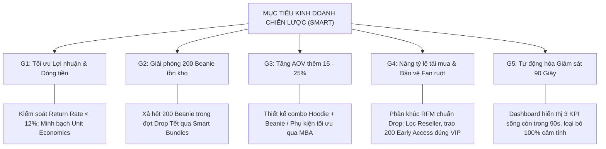
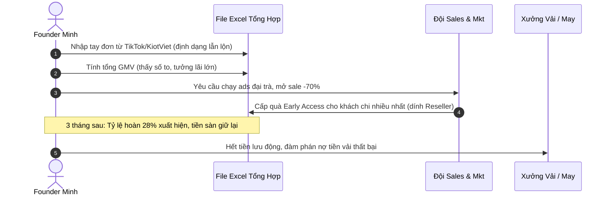
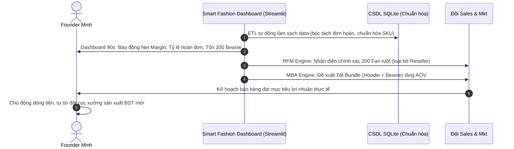
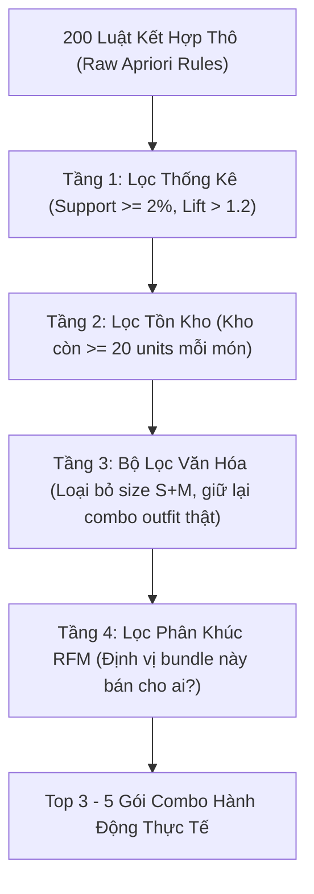

# TÀI LIỆU YÊU CẦU NGHIỆP VỤ (BRD)
## Business Requirements Document
### Dự án: Smart Fashion Business Analytics & Decision Support Dashboard
* **Khách hàng nghiệp vụ:** FORM Studio (Hà Nội, Việt Nam)
* **Người đại diện nghiệp vụ:** Founder Minh
* **Đơn vị tư vấn chiến lược & BA:** Nhóm Chuyên gia Tư vấn Quản trị & BA Mentors
* **Khung chương trình:** Khóa đào tạo Nghiệp vụ BA kết hợp Vibe Coding (Học sinh Khối 11)
* **Phiên bản:** v1.0 | **Ngày ban hành:** 16/10/2026

---

## 1. TỔNG QUAN DỰ ÁN & MỤC TIÊU KINH DOANH

### 1.1. Bối cảnh dự án
FORM Studio là một thương hiệu thời trang streetwear nội địa (Local Brand) tại Hà Nội, hoạt động theo mô hình mở bán theo đợt giới hạn (**Drop Model**) kết hợp bán hàng đa kênh (**Omnichannel**: TikTok Shop Livestream, Shopee, cửa hàng bán lẻ POS/KiotViet).

Mặc dù có sức hút truyền thông lớn (cháy hàng 500 áo hoodie trong 6 giờ livestream), FORM Studio đang đối mặt với khủng hoảng quản trị:
* Ảo ảnh doanh số: Bán hết hàng (Sold-out) nhưng cạn kiệt dòng tiền lưu động để tái sản xuất do chi phí sàn, hoa hồng KOC và tỷ lệ hoàn hàng cao ($10\% - 28\%$).
* Dữ liệu phân mảnh, rác và sai lệch tồn kho tới $26\%$.
* Tiếp thị cào bằng, chưa có chân dung khách hàng sắc nét, nguy cơ mất suất quà Early Access vào tay Reseller/Scalper.
* Tồn kho 200 chiếc mũ len (Beanie) chưa có chiến lược đóng gói combo bán chéo (Cross-sell Bundle) khoa học để nâng cao giá trị đơn hàng trung bình (AOV).

### 1.2. Mục tiêu kinh doanh (Business Goals - SMART)

1. **G1 - Kiểm soát Dòng tiền & Lợi nhuận ròng (Net Profit Focus):**
   * Chuyển đổi tư duy quản trị từ theo dõi GMV sang quản trị Doanh thu thực nhận sau hoàn hàng (**Net Revenue**) và Lợi nhuận ròng (**Net Margin**).
   * Giảm tỷ lệ hoàn đơn từ mức đỉnh $28\%$ xuống dưới $12\%$ thông qua việc nhận diện các nhóm khách hàng và sản phẩm có nguy cơ hoàn cao.
2. **G2 - Tăng giá trị trung bình mỗi đơn hàng (AOV) từ $15\% - 25\%$:**
   * Thay vì chỉ bán lẻ từng món (áo hoodie 590k), xây dựng các gói kết hợp (Bundle) được trợ lực bởi thuật toán khai phá giỏ hàng (MBA).
3. **G3 - Giải phóng dứt điểm 200 chiếc Beanie tồn kho:**
   * Đóng gói Beanie thành sản phẩm bán kèm chiến lược cho đợt Drop Tết tới mà không cần đại hạ giá làm tổn hại giá trị thương hiệu.
4. **G4 - Chuẩn hóa phân khúc khách hàng & Bảo vệ cộng đồng Fan chân chính:**
   * Ứng dụng mô hình RFM điều chỉnh theo nhịp tim Drop Model.
   * Phân bổ chính xác 200 suất quà mua sớm (**Early Access**) cho Fan trung thành thực sự, loại trừ các đối tượng Reseller / Scalper mua gom trục lợi.
5. **G5 - Rút ngắn thời gian ra quyết định điều hành dưới 90 giây:**
   * Cung cấp Executive Dashboard trực quan bằng Streamlit thay thế việc xử lý file Excel thủ công kéo dài hàng giờ.

---

## 2. CÁC BÊN LIÊN QUAN & CHÂN DUNG NGƯỜI DÙNG (STAKEHOLDERS)

| Vai trò (Role) | Đại diện | Nhu cầu kinh doanh cốt lõi (Core Needs) | Điểm đau được giải quyết |
| :--- | :--- | :--- | :--- |
| **Executive / Founder** | Anh Minh | Xem nhanh sức khỏe dòng tiền, doanh thu thực nhận, cảnh báo tồn kho mỗi sáng trong 90 giây để ra quyết định nhập vải/sản xuất. | Chấm dứt cảnh "Sold-out nhưng hết tiền"; loại bỏ quyết định theo cảm tính. |
| **Marketing & CRM Lead** | Nhân viên Marketing | Nhận diện chính xác 5 nhóm khách hàng (VIP, Loyal, Newbie, At-risk, Reseller) để xuất danh sách gửi kịch bản Zalo/SMS/Email cá nhân hóa. | Ngừng tiếp thị cào bằng; không còn gửi nhầm quà VIP cho dân săn sale hoặc reseller. |
| **Sales & Merchandiser** | Nhân viên Bán hàng / Kho | Biết rõ sản phẩm nào hay được mua cùng nhau để thiết kế gói combo, bài trí kệ hàng và tư vấn trên livestream TikTok Shop. | Giải phóng 200 Beanie ứ đọng; tăng tỷ lệ chốt đơn cross-sell tự nhiên. |
| **Operations & Analyst** | Học viên BA Lớp 11 | Sở hữu quy trình ETL chuẩn hóa file dữ liệu bẩn thành cơ sở dữ liệu SQLite sạch, sẵn sàng mở rộng phân tích. | Học được tư duy logic nghiệp vụ thực chiến và cách ứng dụng Vibe coding tạo dashboard. |

---

## 3. PHẠM VI DỰ ÁN (PROJECT SCOPE)

### 3.1. Trong phạm vi (In-Scope)
* **Quản trị & Làm sạch dữ liệu (Data Cleaning & ETL Pipeline):**
  * Xử lý file dữ liệu giao dịch đa kênh từ KiotViet, TikTok Shop, Shopee.
  * Chuẩn hóa định dạng ngày tháng, tiền tệ, mã SKU sản phẩm.
  * Bóc tách rõ ràng giữa **Master Data** (Sản phẩm, Khách hàng) và **Transactional Data** (Đơn hàng, Dòng chi tiết đơn).
  * Tách biệt giao dịch thành công và giao dịch hoàn hàng (`is_returned`).
  * Lưu trữ dữ liệu chuẩn hóa trong cơ sở dữ liệu cục bộ **SQLite** (`data/fashion_brand.db`).
* **Động cơ phân tích & Thuật toán thông minh:**
  * **RFM Engine:** Thuật toán phân khúc khách hàng theo phân vị tương đối (*Percentile*), hiệu chỉnh phù hợp với nhịp mở bán Drop streetwear.
  * **MBA Engine:** Thuật toán Apriori tính toán *Support, Confidence, Lift* kèm Ma trận 4 tầng lọc (Toán học $\rightarrow$ Tồn kho $\rightarrow$ Văn hóa thời trang $\rightarrow$ Phân khúc RFM).
* **Giao diện Dashboard trực quan (Streamlit Web App):**
  * Tầng 1: Executive 90-Second Cockpit (Doanh thu ròng, Tỷ lệ hoàn, Lợi nhuận ròng, Tồn kho cảnh báo).
  * Tầng 2: Customer Insights & Campaign Targeting (Bộ lọc RFM, Xuất danh sách khách hàng).
  * Tầng 3: Basket Explorer & Bundle Recommender (Gợi ý gói combo, giải phóng tồn kho).
  * Ứng dụng cấu trúc thuyết phục **CCR (Context - Complication - Resolution)** trong việc chú giải biểu đồ.

### 3.2. Ngoài phạm vi (Out-of-Scope)
* Tích hợp Webhook/API thời gian thực (Real-time live streaming sync) tới TikTok Shop / Shopee (ở giai đoạn này chỉ nạp dữ liệu theo lô batch dạng file Excel/CSV/SQLite).
* Hệ thống thanh toán trực tuyến hoặc cổng POS thay thế KiotViet.
* Thuật toán Machine Learning phức tạp (Deep Learning, Computer Vision nhận diện hình ảnh trang phục).

---

## 4. QUY TRÌNH NGHIỆP VỤ: HIỆN TẠI (AS-IS) VS. TƯƠNG LAI (TO-BE)

### 4.1. Quy trình As-Is (Hiện tại - Thủ công & Rủi ro)

### 4.2. Quy trình To-Be (Tương lai - Tự động hóa với Dashboard & Dữ liệu sạch)

---

## 5. YÊU CẦU NGHIỆP VỤ CHI TIẾT (BUSINESS REQUIREMENTS)

### 5.1. Nhóm BR-01: Chuẩn hóa & Quản trị Dữ liệu (Data Governance & ETL)
* **BR-01.1: Phân tách mô hình dữ liệu (Data Separation):**
  * Tách biệt rõ ràng **Dữ liệu danh mục (Master Data)**: Bảng `products` (mỗi SKU duy nhất 1 dòng, giá vốn, giá niêm yết) và bảng `customers` (mã khách duy nhất).
  * **Dữ liệu giao dịch (Transactional Data)**: Bảng `orders` (mã đơn, ngày đặt, kênh bán, trạng thái thanh toán, cờ hoàn trả `is_returned`) và bảng `order_items` (chi tiết sản phẩm trong từng đơn).
* **BR-01.2: Tiêu chuẩn hóa định dạng (Normalization):**
  * Toàn bộ ngày tháng quy về chuẩn `YYYY-MM-DD HH:MM:SS`.
  * Tiền tệ chuyển đổi từ các định dạng rác (`450k`, `450.000`, `450,000`) thành số nguyên chuẩn (Integer - VNĐ).
  * Chuẩn hóa mã SKU về chữ hoa viết liền không dấu (ví dụ: `FORM-HOODIE-BLK-M`).
  * Trạng thái đơn hàng quy về bộ danh mục chuẩn: `COMPLETED`, `RETURNED`, `CANCELLED`, `PROCESSING`.
* **BR-01.3: Định danh "Cột linh hồn" (Integrity Key):**
  * Khóa chính không được phép trùng lặp: `order_id` cho đơn hàng, `sku` cho sản phẩm, `customer_id` cho khách hàng. Mọi bản ghi vi phạm phải bị cảnh báo (*Data Quality Flag*).

### 5.2. Nhóm BR-02: Bộ Chỉ số Tài chính & Vận hành Sống còn (Unit Economics & 90s Cockpit)
* **BR-02.1: Công thức tính toán minh bạch:**
  * **Tổng giá trị giao dịch gộp (GMV):** Tổng giá trị niêm yết của tất cả đơn hàng phát sinh.
  * **Doanh thu thuần thực nhận (Net Revenue):** 
    $$\text{Net Revenue} = \sum \text{Đơn hàng COMPLETED} - \text{Chiết khấu khuyến mại}$$
  * **Tỷ lệ hoàn hàng (Return Rate):**
    $$\text{Return Rate} = \frac{\text{Số đơn RETURNED}}{\text{Tổng số đơn hàng}} \times 100\%$$
  * **Lợi nhuận gộp ròng (Net Gross Margin):**
    $$\text{Net Margin} = \text{Net Revenue} - \text{Giá vốn hàng bán (COGS)} - \text{Phí sàn (5-8\%)} - \text{Phí KOC (15-20\%)} - \text{Phí vận chuyển 2 chiều đơn hoàn}$$
* **BR-02.2: Nguyên tắc thiết kế 90 giây của Founder:**
  * Vị trí góc trên cùng bên trái màn hình chính phải đập vào mắt 3 thẻ chỉ số (KPI Cards):
    1. **Doanh thu ròng thực tế** (kèm so sánh % với tuần/tháng trước).
    2. **Tỷ lệ hoàn hàng** (kèm màu cảnh báo: Xanh nếu $<10\%$, Đỏ nếu $>15\%$).
    3. **Biên lợi nhuận ròng ước tính** sau khi trừ chi phí vận hành sàn.
  * Tuyệt đối không hiển thị quá 4 biểu đồ tại màn hình chính để tránh quá tải nhận thức (*Cognitive Load*).

### 5.3. Nhóm BR-03: Động cơ Phân khúc Khách hàng Thông minh (RFM Engine)
* **BR-03.1: Thích ứng với chu kỳ Drop Model (Context-aware Recency):**
  * Không dùng ngưỡng cố định kiểu siêu thị (như <30 ngày = 5 điểm). Thang điểm Recency (R) phải được tính tương đối theo khoảng cách so với đợt Drop gần nhất (chu kỳ 4 - 6 tháng).
* **BR-03.2: Chuẩn hóa theo phân vị tương đối (Percentile Scoring):**
  * Sử dụng phương pháp chia nhóm 5 phân vị (`pd.qcut`) từ 1 đến 5 điểm cho từng chiều R, F, M để triệt tiêu ảnh hưởng làm méo số liệu của các đợt bão sale như 11.11.
* **BR-03.3: Định danh 5 Phân khúc Chiến lược & Hành động tương ứng:**

| Tên phân khúc (Segment) | Đặc điểm R - F - M | Hành vi thực tế tại FORM Studio | Kịch bản hành động đề xuất (Action Trigger) |
| :--- | :--- | :--- | :--- |
| **VIP / Champions** | R: 4-5, F: 4-5, M: 4-5 | Fan cứng, mua đều đặn qua các đợt Drop, mua giá gốc, tự hào về brand. | **Trao quyền ưu tiên:** Tặng 200 suất Early Access, thiệp tay, sản phẩm giới hạn. Tuyệt đối không gửi voucher giảm giá rẻ tiền. |
| **Loyal Customers** | R: 3-4, F: 3-5, M: 3-4 | Mua thường xuyên, tương tác tốt, đóng góp doanh thu ổn định. | **Chăm sóc đặc biệt:** Mời tham gia Private Community, khảo sát ý kiến thiết kế mẫu mới. |
| **Potential / Newbies** | R: 4-5, F: 1, M: 2-3 | Vừa mua lần đầu trong chiến dịch gần nhất, hào hứng nhưng chưa hiểu sâu về brand. | **Onboarding:** Kể câu chuyện thương hiệu (*Brand Story*), hướng dẫn cách phối đồ (*Lookbook*). |
| **At-risk Customers** | R: 1-2, F: 3-5, M: 3-5 | Từng là khách thân thiết nhưng đã im lặng 4-6 tháng nay. | **Win-back Campaign:** Gửi tin nhắn Zalo cá nhân hóa đánh thức kỷ niệm trước đợt Drop mới 2 tuần. |
| **Discount Hunters & Resellers** | F cao bất thường hoặc R cao chỉ vào đợt sale; M thấp hoặc mua gom nhiều size | Chỉ xuất hiện khi có flash sale -70% hoặc mua gom size S+M để bán lại kiếm lời. | **Loại trừ khỏi Early Access:** Không cấp suất ưu tiên; chỉ remarketing khi cần xả kho tồn mùa cũ. |

* **BR-03.4: Bộ lọc chống Reseller / Scalper (Reseller Detection Flag):**
  * Gắn cờ cảnh báo nếu một khách hàng mua $\ge 3$ chiếc áo cùng mẫu nhưng khác kích cỡ trong cùng 1 đơn hàng mà không có lịch sử mua phụ kiện.

### 5.4. Nhóm BR-04: Động cơ Khám phá Giỏ hàng & Bán chéo (MBA & Smart Bundles)
* **BR-04.1: Các chỉ số toán học giỏ hàng (Apriori Algorithm):**
  * **Độ phổ biến (Support):** Tỷ lệ đơn hàng chứa cả item A và item B trên tổng số đơn. Ngưỡng tối thiểu: $\text{Support} \ge 2\%$.
  * **Độ tin cậy (Confidence):** Tỷ lệ khách mua B khi đã chọn A. Ngưỡng tối thiểu: $\text{Confidence} \ge 30\%$.
  * **Hệ số tương quan (Lift):** Xác suất mua kèm A và B so với việc mua ngẫu nhiên. Chỉ xem xét các cặp có $\text{Lift} > 1.2$ (sản phẩm thực sự "hút" nhau).
* **BR-04.2: Quy trình Ma trận 4 Tầng lọc (The 4-Layer Filter):**

* **BR-04.3: Bài toán cụ thể giải phóng 200 chiếc Beanie:**
  * Hệ thống phải ưu tiên tìm kiếm các luật kết hợp có chứa SKU `BEANIE-001`.
  * Nếu luật `{Hoodie} -> {Beanie}` thỏa mãn Lift > 1.5 và kho còn 200 chiếc: Đề xuất đóng gói combo mang tên thương quyền (ví dụ: *"Hype Duo Set"* hoặc *"Tết Drop Box"*), định giá tâm lý (ví dụ: Hoodie 590k + Beanie 290k = 880k $\rightarrow$ Combo trọn vẹn 799k).

### 5.5. Nhóm BR-05: Kể chuyện bằng Dữ liệu & Tiêu chuẩn Trình bày (Data Storytelling & CCR)
* **BR-05.1: Ứng dụng công thức CCR (Context - Complication - Resolution):**
  * Mọi biểu đồ và bảng phân tích quan trọng phải có chú giải theo cấu trúc 3 phần:
    1. **Bối cảnh (Context):** Tình hình thực tế (ví dụ: *Chiến dịch 11.11 ghi nhận doanh thu tăng 40%*).
    2. **Xung đột / Vấn đề (Complication):** Điểm nghẽn dữ liệu (ví dụ: *Tuy nhiên AOV giảm 22% và tỷ lệ hoàn đạt 28%, kéo biên lợi nhuận ròng xuống mức âm*).
    3. **Hành động giải quyết (Resolution):** Khuyến nghị ra quyết định (ví dụ: *Cần dừng sale đại trà, chuyển sang bán bundle cho Newbie và mở Early Access cho VIP*).
* **BR-05.2: Tiêu chuẩn kiểm thử im lặng (Blind Test Ready):**
  * Giao diện phải tự giải thích được, người dùng lần đầu nhìn vào không cần tác giả đứng cạnh hướng dẫn mà vẫn hiểu được 80% thông điệp trong vòng 3 phút.

---

## 6. QUY TẮC NGHIỆP VỤ (BUSINESS RULES)

* **BR-RULE-01 (Định nghĩa Đơn thành công):** Chỉ các đơn có trạng thái `COMPLETED` mới được ghi nhận vào Doanh thu thực nhận. Các đơn `RETURNED` phải tính vào tỷ lệ hoàn và hạch toán chi phí vận chuyển 2 chiều vào chi phí bán hàng.
* **BR-RULE-02 (Chu kỳ RFM Drop):** Điểm R được tính dựa trên số ngày trôi qua kể từ ngày phát sinh giao dịch gần nhất tới ngày mở đợt Drop tiếp theo.
* **BR-RULE-03 (Bảo vệ Tồn kho Bundle):** Không đề xuất các combo có chứa sản phẩm mà tồn kho khả dụng dưới 10 chiếc để tránh tình trạng đơn hàng bị hủy do hết hàng cục bộ.
* **BR-RULE-04 (Quyền ưu tiên Early Access):** Danh sách 200 suất Early Access được lọc độc quyền từ phân khúc `VIP / Champions` và `Loyal Customers` có điểm Frequency $\ge 3$ và không bị gắn cờ Reseller.

---

## 7. YÊU CẦU PHI CHỨC NĂNG (NON-FUNCTIONAL REQUIREMENTS)

* **NFR-01 (Tính dễ hiểu & Tiếp cận cho học sinh cấp 3):** Mã nguồn Python và cấu trúc thư mục rõ ràng, có chú thích bằng tiếng Việt, chia tách module logic (`srcs/etl.py`, `srcs/rfm.py`, `srcs/mba.py`, `srcs/app.py`).
* **NFR-02 (Hiệu năng xử lý):** Toàn bộ pipeline ETL và tính toán thuật toán trên tệp dữ liệu 5,000 - 10,000 dòng phải chạy hoàn tất dưới 5 giây trên máy tính cá nhân tiêu chuẩn.
* **NFR-03 (Công nghệ mở & Không phụ thuộc Cloud đắt tiền):** Chạy 100% trên nền tảng cục bộ (Localhost) với Python 3.10+, thư viện Streamlit, Pandas, Scikit-learn / Mlxtend và SQLite3.
* **NFR-04 (Bảo mật & Toàn vẹn dữ liệu):** Dữ liệu khách hàng (số điện thoại, tên) được bảo vệ nội bộ, không gửi ra các dịch vụ API bên ngoài không an toàn.

---

## 8. TIÊU CHÍ NGHIỆM THU NGHIỆP VỤ (BUSINESS ACCEPTANCE CRITERIA)

Dự án được đánh giá là hoàn thành giai đoạn yêu cầu nghiệp vụ khi thỏa mãn các tiêu chí sau:
1. **AC-1:** Bảng dữ liệu SQLite bóc tách hoàn chỉnh Master Data và Transactional Data, không còn lỗi lệch định dạng ngày, tiền tệ hay SKU.
2. **AC-2:** Dashboard Streamlit hiển thị chính xác 3 chỉ số chính trong vòng 90 giây khi tải trang.
3. **AC-3:** Mô hình RFM phân loại thành công 5 phân khúc khách hàng, xuất được danh sách 200 khách hàng nhận suất Early Access sạch không có Reseller.
4. **AC-4:** Thuật toán MBA gợi ý được ít nhất 2 phương án combo tối ưu giúp giải phóng 200 chiếc Beanie tồn kho với hệ số Lift $> 1.5$.
5. **AC-5:** Đạt bài kiểm tra Blind Test: Người dùng ngoài dự án đọc hiểu dashboard và chỉ ra được các quyết định kinh doanh cần làm trong 3 phút.

---
*(Tài liệu này được dùng làm căn cứ chính thức để xây dựng Tài liệu Đặc tả Yêu cầu Phần mềm SRS và Thiết kế Kỹ thuật SAD trong các bước tiếp theo).*
