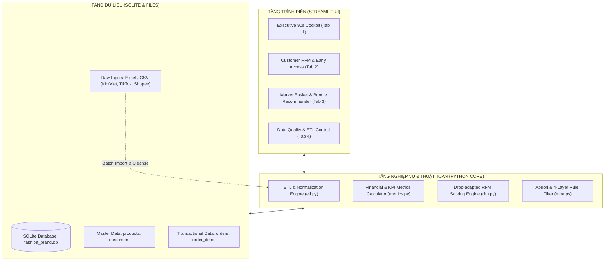
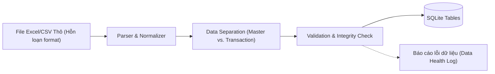
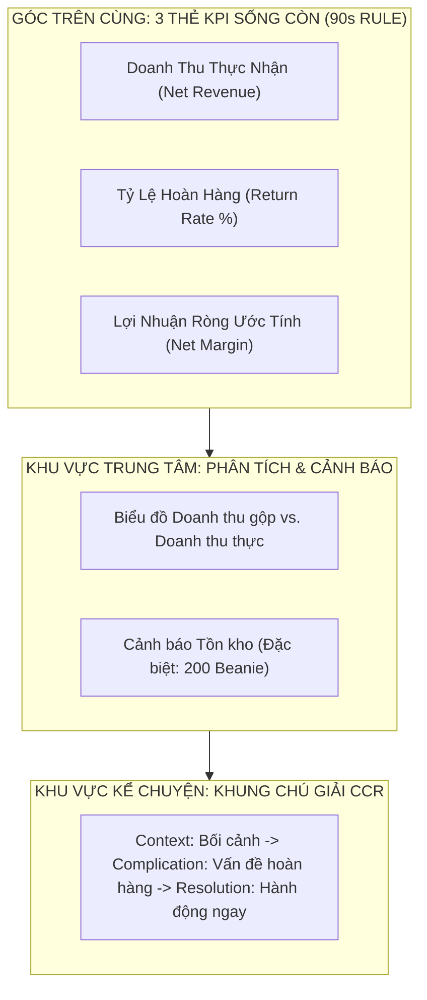
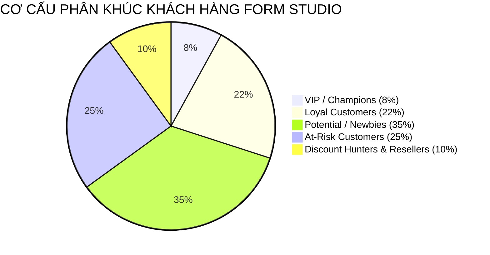
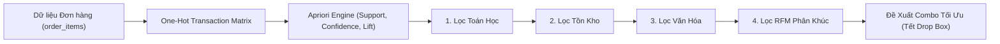
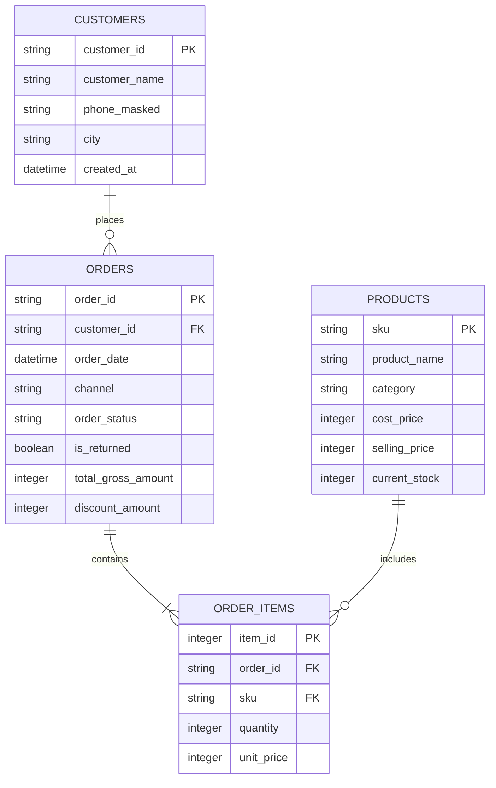

# ĐẶC TẢ YÊU CẦU PHẦN MỀM (SRS)
## Software Requirements Specification
### Hệ thống: Smart Fashion Business Analytics & Decision Support Dashboard
* **Khách hàng nghiệm thu:** FORM Studio (Hà Nội, Việt Nam)
* **Người thụ hưởng:** Founder Minh, Đội ngũ Marketing, Sales & Kho vận
* **Đối tượng kỹ thuật:** Học sinh Lớp 11 (Chương trình BA & Vibe Coding)
* **Phiên bản:** v1.0 | **Ngày ban hành:** 16/10/2026
* **Tài liệu tham chiếu:** [01_Khao_sat_Hien_trang_Form_Studio.md](file:///c:/Users/Admin/Workspaces/gsj-localbrand-src/docs/01_Khao_sat_Hien_trang_Form_Studio.md), [02_Tai_lieu_Yeu_cau_Nghiep_vu_BRD.md](file:///c:/Users/Admin/Workspaces/gsj-localbrand-src/docs/02_Tai_lieu_Yeu_cau_Nghiep_vu_BRD.md)

---

## 1. GIỚI THIỆU (INTRODUCTION)

### 1.1. Mục đích tài liệu
Tài liệu Đặc tả Yêu cầu Phần mềm (SRS) này chi tiết hóa các yêu cầu nghiệp vụ trong [BRD](file:///c:/Users/Admin/Workspaces/gsj-localbrand-src/docs/02_Tai_lieu_Yeu_cau_Nghiep_vu_BRD.md) thành các đặc tả kỹ thuật, chức năng phần mềm, luồng giao dịch, cấu trúc dữ liệu và giao diện người dùng. Tài liệu đóng vai trò là "bản vẽ thi công" để học sinh lớp 11 tiến hành **Vibe coding** xây dựng ứng dụng với **Python, Streamlit và SQLite**.

### 1.2. Phạm vi phần mềm
Ứng dụng **Smart Fashion Dashboard** là một hệ thống phân tích kinh doanh nội bộ (Internal Business Intelligence & Decision Support System) chạy trên môi trường Web cục bộ (Localhost), cung cấp 4 phân hệ chính:
1. **Phân hệ ETL & Data Cleansing:** Tự động hóa chuẩn hóa dữ liệu bẩn và lưu trữ vào SQLite.
2. **Phân hệ Executive 90s Cockpit:** Bảng điều hành giám sát sức khỏe tài chính & vận hành trong 90 giây.
3. **Phân hệ RFM Customer Intelligence:** Phân tích chân dung khách hàng, phát hiện Reseller và xuất danh sách 200 suất Early Access sạch.
4. **Phân hệ Market Basket Analysis (MBA):** Khai phá giỏ hàng, ứng dụng 4 tầng lọc đề xuất gói bán kèm (Bundle) giải phóng 200 chiếc Beanie tồn kho.

### 1.3. Định nghĩa & Từ viết tắt
* **GMV (Gross Merchandise Value):** Tổng giá trị giao dịch gộp trước khi trừ hoàn đơn và chi phí.
* **Net Revenue:** Doanh thu thuần thực tế sau khi đã trừ các đơn hàng bị hoàn trả (`RETURNED`).
* **Net Margin:** Biên lợi nhuận ròng sau khi trừ chi phí giá vốn (COGS), phí sàn, hoa hồng KOC và phí hoàn hàng.
* **Drop Model:** Mô hình bán hàng theo từng đợt ra mắt bộ sưu tập giới hạn đặc trưng của ngành Streetwear.
* **AOV (Average Order Value):** Giá trị trung bình trên một đơn hàng thành công.
* **RFM:** Mô hình phân khúc khách hàng theo Recency (Độ mới), Frequency (Tần suất), Monetary (Giá trị tiền).
* **MBA:** Phân tích giỏ hàng (Market Basket Analysis) sử dụng thuật toán Apriori tính Support, Confidence, Lift.
* **CCR:** Cấu trúc kể chuyện bằng dữ liệu (Context - Complication - Resolution).

---

## 2. MÔ TẢ TỔNG QUAN HỆ THỐNG (SYSTEM OVERVIEW)

### 2.1. Kiến trúc phân tầng tổng thể
Hệ thống được thiết kế theo kiến trúc 3 tầng tinh gọn (3-Tier Lightweight Architecture), tối ưu cho việc phát triển nhanh và dễ bảo trì:



### 2.2. Các nhân vật vận hành hệ thống (User Personas)
* **Founder Minh (Executive):** Sử dụng Tab 1 hàng ngày lúc đầu giờ sáng trong 90 giây để nắm bắt doanh thu thực, tỷ lệ hoàn đơn và quyết định dòng tiền sản xuất.
* **Marketing Specialist (CRM Lead):** Sử dụng Tab 2 trước mỗi đợt Drop để lọc danh sách 200 khách VIP nhận thiệp mời Early Access, cấu hình chiến dịch Zalo win-back cho nhóm At-risk.
* **Merchandiser / Livestream Lead:** Sử dụng Tab 3 để lựa chọn các cặp combo sản phẩm có hệ số Lift cao, hỗ trợ MC chốt đơn combo trên TikTok Live.
* **Student Data Analyst (Học viên BA Lớp 11):** Sử dụng Tab 4 để nhập file dữ liệu mới, chạy kiểm thử độ sạch dữ liệu (Sanity Check) và xử lý ngoại lệ.

---

## 3. ĐẶC TẢ YÊU CẦU CHỨC NĂNG (FUNCTIONAL REQUIREMENTS)

### 3.1. Phân hệ SF-01: Quản trị, Làm sạch Dữ liệu & ETL (Data Ingestion & ETL)



* **SF-01.1: Nhập và Phân tích Cú pháp File thô (Data Parsing):**
  * Hệ thống cho phép người dùng tải lên file Excel (`.xlsx`) hoặc `.csv` từ thanh điều khiển (Sidebar).
  * Hỗ trợ tự động nhận diện các định dạng ngày tháng đa dạng: `DD/MM/YYYY`, `YYYY-MM-DD`, `D tháng M`. Quy đổi toàn bộ về chuẩn chuẩn ISO-8601: `YYYY-MM-DD HH:MM:SS`.
  * Chuẩn hóa cột tiền tệ: Tự động loại bỏ ký tự không phải số (`.`, `,`, `k`, `đ`, `VND`), chuyển đổi thành số nguyên (`INTEGER`).
* **SF-01.2: Chuẩn hóa Mã hàng (SKU Normalization):**
  * Tự động xóa khoảng trắng thừa, chuyển về chữ in hoa không dấu: `form-001` $\rightarrow$ `FORM-001`.
* **SF-01.3: Tách dữ liệu Danh mục và Giao dịch (Relational Split):**
  * Tự động bóc tách thành 4 bảng CSDL SQLite:
    1. `products`: `sku` (PK), `product_name`, `category`, `cost_price`, `selling_price`, `current_stock`.
    2. `customers`: `customer_id` (PK), `customer_name`, `phone_masked`, `city`.
    3. `orders`: `order_id` (PK), `customer_id` (FK), `order_date`, `channel`, `order_status`, `is_returned`, `discount_amount`.
    4. `order_items`: `item_id` (PK), `order_id` (FK), `sku` (FK), `quantity`, `unit_price`.
* **SF-01.4: Báo cáo Sức khỏe Dữ liệu (Data Health Check):**
  * Thống kê tỷ lệ bản ghi bị lỗi, số lượng SKU bị trùng hoặc thiếu thông tin, số đơn hàng thiếu `customer_id` (Guest checkout).

---

### 3.2. Phân hệ SF-02: Bảng Điều hành 90 Giây (Executive 90s Cockpit)



* **SF-02.1: Hiển thị Bộ 3 Thẻ Chỉ số Sống còn (Executive KPI Cards):**
  * **Card 1 - Net Revenue:** Giá trị tổng đơn hoàn thành (sau trừ đơn hoàn). Kèm chỉ số tăng trưởng $\Delta\%$ so với kỳ trước.
  * **Card 2 - Return Rate:** Tỷ lệ % đơn `RETURNED`. Cảnh báo trực quan:
    * Xanh lá nếu $< 10\%$.
    * Vàng nếu $10\% - 15\%$.
    * Đỏ nhấp nháy nếu $> 15\%$ (mức báo động).
  * **Card 3 - Net Margin:** Ước tính lợi nhuận ròng dựa trên công thức Unit Economics:
    $$\text{Net Margin} = \text{Net Revenue} - \text{COGS} - \text{Phí sàn (7\%)} - \text{Phí KOC (18\%)} - \text{Phí hoàn (30k/đơn)}$$
* **SF-02.2: Biểu đồ Xu hướng & Bóc tách Dòng tiền (Cash Gap Trend):**
  * Biểu đồ đường kép (Dual-line chart): Đường 1 là GMV (Ảo ảnh bán hàng), Đường 2 là Net Revenue (Thực nhận). Khoảng trống giữa 2 đường phản ánh mức độ thất thoát do hoàn hàng và chiết khấu.
* **SF-02.3: Widget Cảnh báo Tồn kho Nóng (Inventory Alert):**
  * Bảng cảnh báo các sản phẩm có vòng quay chậm, nổi bật là dòng `BEANIE-001` (Tồn kho: 200 units, Vòng quay tồn kho $< 0.2$).
* **SF-02.4: Khung Tường thuật CCR (CCR Dynamic Narrative):**
  * Tự động sinh văn bản nhận định tình hình kinh doanh theo cấu trúc:
    * **Context:** "Tuần qua FORM Studio ghi nhận 850 đơn hàng qua kênh TikTok Live..."
    * **Complication:** "Tuy nhiên, tỷ lệ hoàn hàng tăng đột biến lên 24.5%, làm thâm hụt 42 triệu đồng dòng tiền thực nhận..."
    * **Resolution:** "Đề xuất rà soát lại bảng tư vấn kích cỡ (Size chart) và tạm dừng chương trình Flash Sale cho nhóm sản phẩm áo khoác..."

---

### 3.3. Phân hệ SF-03: Phân tích Chân dung Khách hàng & Săn Reseller (RFM Module)

* **SF-03.1: Động cơ tính điểm RFM Thích ứng (Drop-adapted RFM Calculation):**
  * **Recency (R):** Số ngày tính từ lần mua gần nhất đến ngày chạy phân tích (hoặc mốc Drop kế tiếp). Thang điểm 1 đến 5.
  * **Frequency (F):** Tổng số đơn hàng thành công (`COMPLETED`) của khách hàng trong 12 tháng.
  * **Monetary (M):** Tổng chi tiêu thực tế của khách hàng (không tính giá trị đơn hoàn).
  * Phân vị hoá bằng `pd.qcut` để đảm bảo phân bổ điểm tương đối chuẩn xác, không bị bão sale 11.11 làm lệch.
* **SF-03.2: Ma trận Phân khúc 5 Nhóm Khách hàng:**



* **SF-03.3: Thuật toán Phát hiện Reseller / Scalper (Reseller Hunter):**
  * Tiêu chí gắn cờ (`is_reseller = True`):
    * Đơn hàng chứa $\ge 3$ chiếc cùng 1 loại áo nhưng khác size (S, M, L).
    * Tỷ lệ mua sản phẩm phụ kiện (tất, mũ, móc khóa) $= 0\%$.
    * Chỉ phát sinh giao dịch trong khung giờ flash sale hoặc ngày Drop đầu tiên.
* **SF-03.4: Xuất Danh sách 200 Suất Early Access (Export VIP List):**
  * Nút chức năng `[Xuất Danh Sách 200 Early Access]`.
  * Bộ lọc tự động: Chọn Top 200 khách hàng có điểm $R \ge 4$, $F \ge 3$, $M \ge 4$, và `is_reseller == False`.
  * File xuất ra định dạng `.csv` chứa: `customer_id`, `name`, `phone_masked`, `vip_tier`, `action_recommended`.

---

### 3.4. Phân hệ SF-04: Khám phá Giỏ hàng & Gợi ý Bundle (Market Basket Analysis)



* **SF-04.1: Ma trận Giao dịch & Thuật toán Apriori:**
  * Chuyển đổi dữ liệu `order_items` thành ma trận nhị phân (One-Hot Encoded Transaction Matrix) dạng: mỗi hàng là một `order_id`, mỗi cột là một `sku` (giá trị 1 nếu có trong đơn, 0 nếu không).
  * Tính toán 3 chỉ số then chốt:
    * $\text{Support}(A \rightarrow B) = P(A \cap B)$
    * $\text{Confidence}(A \rightarrow B) = P(B \mid A)$
    * $\text{Lift}(A \rightarrow B) = \frac{P(B \mid A)}{P(B)}$
* **SF-04.2: Tương tác 4 Tầng lọc (Interactive 4-Layer Filter Slider):**
  * **Thanh trượt 1 (Thống kê):** Cho phép người dùng chỉnh ngưỡng $\text{Support} \ge 2\%$, $\text{Lift} \ge 1.3$.
  * **Hộp chọn 2 (Tồn kho):** Checkbox `[Chỉ hiện sản phẩm có tồn kho >= 20 units]`.
  * **Hộp chọn 3 (Bộ lọc văn hóa):** Checkbox `[Loại trừ kết hợp cùng loại khác size (S + M)]`.
  * **Hộp chọn 4 (Mục tiêu tiếp thị):** Chọn đối tượng nhắm đến (`All`, `VIP Early Access`, `Newbie Onboarding`, `At-Risk Win-back`).
* **SF-04.3: Module Chuyên biệt "Giải cứu 200 Beanie" (Beanie Liquidation Advisor):**
  * Tự động quét và truy xuất mọi quy tắc kết hợp có vế kết quả (`consequents`) hoặc vế giả định (`antecedents`) chứa mã `BEANIE-001`.
  * Khi phát hiện luật `{HOODIE-BLK} -> {BEANIE-001}` (với Lift = 1.85, Confidence = 42%):
    * Hiển thị bảng mô phỏng giá trị gói combo: Áo Hoodie (590.000đ) + Mũ Beanie (290.000đ) = 880.000đ.
    * Gợi ý mức định giá chiến lược: **799.000đ** (Tiết kiệm 81.000đ, giữ nguyên cảm giác sản phẩm cao cấp, tăng AOV thêm $35\%$).
    * Đặt tên thương mại đề xuất: **"Tết Streetwear Set"** hoặc **"FORM Winter Duo"**.

---

## 4. YÊU CẦU GIAO DIỆN NGƯỜI DÙNG (USER INTERFACE SPECIFICATION)

### 4.1. Bố cục Wireframe tổng thể (Streamlit Layout)

```
+------------------------------------------------------------------------------------------------------+
|  FORM STUDIO - SMART FASHION BUSINESS DASHBOARD                                [Help / Blind Test]   |
+------------------------------------------------------------------------------------------------------+
| SIDEBAR                 | MAIN CONTENT AREA                                                          |
|                         | [Tab 1: Executive 90s] [Tab 2: RFM Customer] [Tab 3: MBA Bundles] [Tab 4: ETL]  |
| * Nạp file dữ liệu      |----------------------------------------------------------------------------|
|   [Upload CSV/Excel]    | [ CARD 1: NET REVENUE ]    [ CARD 2: RETURN RATE ]    [ CARD 3: NET MARGIN ]   |
|                         |  485,200,000 đ (+12.4%)     11.2% (Canh bao: Vang)     28.4% (Dat chi tieu) |
| * Bộ lọc thời gian:     |----------------------------------------------------------------------------|
|   [ 30 ngay qua      v] | KHUNG NHẬN ĐỊNH ĐIỀU HÀNH (CCR NARRATIVE):                                 |
|                         | Context: Doanh thu tuan qua on dinh voi 850 don hang...                    |
| * Bộ lọc kênh bán:      | Complication: Tỷ le hoan don Hoodie Black size L tang dot bien 18%...       |
|   [x] TikTok Shop       | Resolution: Can kiem tra lai chat lieu vai lot va cap nhat size chart ngay...|
|   [x] Shopee            |----------------------------------------------------------------------------|
|   [x] KiotViet Offline  | BIỂU ĐỒ XU HƯỚNG DÒNG TIỀN (GMV vs. NET REVENUE):                          |
|                         | [~~~~~~~~~~~~~~~~~~~~ Biểu đồ 2 đường chênh lệch ~~~~~~~~~~~~~~~~~~~~~~]   |
| * Cài đặt tham số Drop: |----------------------------------------------------------------------------|
|   Ngày Drop kế: 01/11   | DANH MỤC CẢNH BÁO TỒN KHO NÓNG:                                            |
|                         | * BEANIE-001: Ton 200 chiec | Ty le ban: Cham -> Goi y dong goi combo!     |
+------------------------------------------------------------------------------------------------------+
```

### 4.2. Nguyên tắc thiết kế Visual & Trải nghiệm người dùng (UX Principles)
1. **Nguyên tắc "Thở" (Whitespace):** Không nhồi nhét quá nhiều chart con trên một màn hình; ưu tiên độ rộng và khoảng cách giữa các phần tử.
2. **Quy tắc phối màu chiến lược:**
   * Màu đen / xám đậm (`#1E1E1E`): Tông màu chủ đạo của thời trang streetwear cá tính.
   * Màu xanh lục lá (`#2ECC71`): Tín hiệu tích cực (Doanh thu vượt kế hoạch, Tỷ lệ hoàn an toàn $<10\%$).
   * Màu đỏ nổi bật (`#E74C3C`): Cảnh báo nguy hiểm (Tỷ lệ hoàn $>15\%$, Dòng tiền âm).
3. **Tiêu chuẩn Caption theo phong cách Financial Times:**
   * Mọi tiêu đề biểu đồ đều phải là một thông điệp kết luận hành động, không đặt tên biểu đồ chung chung (Ví dụ: Thay vì đặt *"Doanh thu theo tuần"*, đặt *"Doanh thu tuần 42 phục hồi 14% nhờ mở bán sớm cho khách VIP"*).

---

## 5. MÔ HÌNH DỮ LIỆU & QUAN HỆ CƠ SỞ DỮ LIỆU (DATABASE SCHEMA)



---

## 6. YÊU CẦU PHI CHỨC NĂNG (NON-FUNCTIONAL REQUIREMENTS)

* **NFR-PERF-01 (Thời gian nạp & phản hồi):**
  * Tải giao diện trang chủ trong vòng $\le 2$ giây.
  * Thuật toán RFM và Apriori tính toán trên bộ dữ liệu $10,000$ đơn hàng chạy không quá $4$ giây trên laptop Core i5 / 8GB RAM tiêu chuẩn.
* **NFR-USAB-02 (Chuẩn Blind Test):**
  * Học sinh lớp 11 hoặc người dùng không có kiến thức kỹ thuật có thể tự vận hành và giải thích được insight chính sau 3 phút quan sát mà không cần người lập trình hướng dẫn.
* **NFR-PORT-03 (Khả năng triển khai cục bộ):**
  * Không đòi hỏi cài đặt server phức tạp (Apache, Nginx, Docker). Chỉ cần môi trường Python thuần với lệnh chạy: `streamlit run srcs/app.py`.
* **NFR-CODE-04 (Tính sư phạm & Cấu trúc mã nguồn):**
  * Toàn bộ mã nguồn viết sạch (Clean Code), có docstring chú thích chi tiết bằng tiếng Việt cho từng hàm thuật toán, phục vụ mục tiêu học tập Vibe coding.

---

## 7. MA TRẬN TRUY XUẤT YÊU CẦU (REQUIREMENTS TRACEABILITY MATRIX - RTM)

| Yêu cầu Nghiệp vụ (BRD) | Chức năng Phần mềm (SRS) | Module Mã nguồn (`srcs/`) | Phương pháp Kiểm thử Nghiệm thu |
| :--- | :--- | :--- | :--- |
| **BR-01 (Data Governance)** | SF-01 (Parser, Normalizer, SQLite ETL) | `srcs/etl.py` | Unit Test: Xử lý file dữ liệu bẩn có định dạng ngày, tiền tệ lỗi. |
| **BR-02 (Executive 90s)** | SF-02 (3 KPI Cards, Net Margin, CCR) | `srcs/app.py`, `srcs/metrics.py` | UI Test: Đo thời gian đọc insight $\le 90$ giây. |
| **BR-03 (RFM Drop Streetwear)** | SF-03 (Percentile RFM, Reseller Hunter) | `srcs/rfm.py` | Logic Test: Xuất danh sách 200 Early Access, kiểm tra cờ Reseller. |
| **BR-04 (MBA & 200 Beanie)** | SF-04 (Apriori, 4-Layer Filter, Bundle) | `srcs/mba.py` | Algorithm Test: Kiểm tra Support, Lift của cặp Hoodie + Beanie. |
| **BR-05 (Data Storytelling)** | SF-02.4, SF-05 (Caption CCR, Sanity Check) | `srcs/app.py` | Blind Test: Đánh giá khả năng tự hiểu của người dùng. |

---
*(Tài liệu này là căn cứ chuẩn mực để triển khai Tài liệu Thiết kế Chi tiết Kỹ thuật SAD và bước vào giai đoạn Vibe coding mã nguồn trong `srcs/`).*
