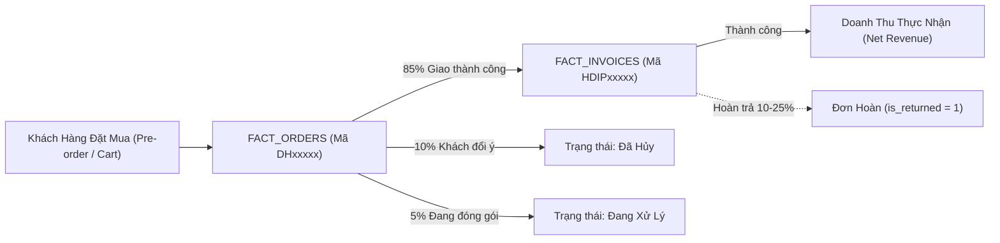
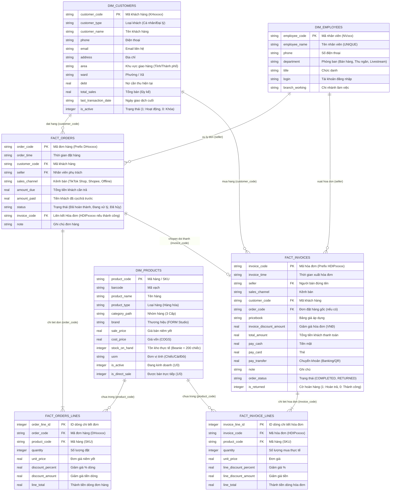

# THIẾT KẾ CƠ SỞ DỮ LIỆU TƯƠNG THÍCH KIOTVIET & KIẾN TRÚC KỸ THUẬT (SAD)
## Software Architecture & Database Design Document
### Dự án: Smart Fashion Business Analytics Dashboard
* **Doanh nghiệp ứng dụng:** FORM Studio (Hà Nội, Việt Nam)
* **Hệ thống nguồn đối ứng:** Phần mềm Quản lý Bán lẻ KiotViet (Mô hình Bán lẻ Đa kênh Omnichannel)
* **Tài liệu tham chiếu chuẩn:** 
  * [01_DATA_STRUCTURE_ANALYSIS.md](file:///c:/Users/Admin/Workspaces/gsj-localbrand-src/docs/01_DATA_STRUCTURE_ANALYSIS.md)
  * [GSJ_Huong dan thuc hanh.md](file:///c:/Users/Admin/Workspaces/gsj-localbrand-src/docs/requirements/GSJ_Huong%20dan%20thuc%20hanh.md)
  * [BA_for_Smart_Fashion_Textbook.docx.md](file:///c:/Users/Admin/Workspaces/gsj-localbrand-src/docs/requirements/BA_for_Smart_Fashion_Textbook.docx.md)
* **Phiên bản:** v2.0 (Bổ sung đầy đủ thực thể ORDERS & ORDER_LINES) | **Ngày cập nhật:** 16/10/2026

---

## 1. TỔNG QUAN KIẾN TRÚC & PHÂN BIỆT ĐƠN HÀNG (ORDERS) VS. HÓA ĐƠN (INVOICES)

Trong nghiệp vụ bán lẻ KiotViet và đặc thù ngành thời trang Streetwear (Drop Model), quá trình bán hàng bao gồm 2 giai đoạn kế tiếp nhau với bản chất nghiệp vụ hoàn toàn khác nhau:

### 1.1. Vai trò của Đơn đặt hàng (ORDERS & ORDER_LINES)
* **Bản chất:** Giai đoạn khách hàng **dự định mua hàng hoặc đặt trước (Pre-order)**, giữ chỗ sản phẩm trong đợt Drop hoặc trên giỏ hàng sàn TMĐT (TikTok Shop, Shopee, Fanpage).
* **Đặc điểm:** Số lượng, chủng loại hàng hóa có thể bị thay đổi hoặc hủy bỏ. Lúc này **chưa phát sinh thanh toán thực tế** và **chưa ghi nhận doanh thu kế toán**.
* **Ý nghĩa phân tích cho BA:**
  * Giúp tính toán **Tỷ lệ chuyển đổi đơn hàng (Order Conversion Rate)**: Tỷ lệ đơn đặt hàng chuyển thành hóa đơn thanh toán thành công.
  * Đo lường **Tỷ lệ hủy đơn (Cancellation Rate / Drop-off Rate)**: Những khách đặt đơn nhưng sau đó hủy do phí ship, đổi ý hoặc chờ giao quá lâu.
  * Phân tích nhu cầu thị trường thực tế (Demand Forecasting) trước khi quyết định sản xuất.

### 1.2. Vai trò của Hóa đơn (INVOICES & INVOICE_LINES)
* **Bản chất:** Kết quả của giao dịch thành công khi hàng hóa đã được xuất kho, xử lý đóng gói, thanh toán và chuyển giao cho khách hàng (hoặc phát sinh đổi trả).
* **Đặc điểm:** Là cơ sở pháp lý và kế toán để **ghi nhận doanh thu thuần, dòng tiền thực nhận, và theo dõi tỷ lệ hoàn hàng (Return Rate)**.

---

## 2. SƠ ĐỒ THỰC THỂ QUAN HỆ TOÀN DIỆN (ERD DIAGRAM)

---

## 3. CHI TIẾT BẢNG DỮ LIỆU ORDERS & ORDER_LINES (DATA DICTIONARY)

### 3.1. Bảng `FACT_ORDERS` (Đơn đặt hàng)
| Tên cột | Kiểu dữ liệu | Khóa | Ràng buộc | Ý nghĩa nghiệp vụ |
| :--- | :--- | :--- | :--- | :--- |
| `order_code` | TEXT | PRIMARY KEY | Prefix `DH` theo chuẩn KiotViet | Mã đơn đặt hàng (VD: `DH00001`, `DH00002`) |
| `order_time` | TEXT | | ISO-8601 `YYYY-MM-DD HH:MM:SS` | Thời điểm khách đặt đơn trên hệ thống |
| `customer_code` | TEXT | FOREIGN KEY | `REFERENCES DIM_CUSTOMERS(customer_code)` | Khách hàng thực hiện đặt đơn |
| `seller` | TEXT | FOREIGN KEY | `REFERENCES DIM_EMPLOYEES(employee_name)` | Nhân viên tiếp nhận đơn hoặc kênh bán |
| `sales_channel` | TEXT | | NOT NULL | Kênh đặt hàng (TikTok Shop, Shopee, Offline) |
| `amount_due` | REAL | | `>= 0` | Tổng giá trị đơn hàng khách cần thanh toán |
| `amount_paid` | REAL | | `>= 0` | Số tiền khách đã thanh toán trước (cọc) |
| `status` | TEXT | | `Đã hoàn thành`, `Đang xử lý`, `Đã hủy` | Trạng thái vòng đời của đơn đặt hàng |
| `invoice_code` | TEXT | FOREIGN KEY | `REFERENCES FACT_INVOICES(invoice_code)` | Mã hóa đơn sinh ra nếu đơn hoàn thành |
| `note` | TEXT | | | Ghi chú đơn (Lý do hủy đơn, ghi chú size) |

### 3.2. Bảng `FACT_ORDERS_LINES` (Chi tiết dòng đơn đặt hàng)
| Tên cột | Kiểu dữ liệu | Khóa | Ràng buộc | Ý nghĩa nghiệp vụ |
| :--- | :--- | :--- | :--- | :--- |
| `order_line_id` | INTEGER | PRIMARY KEY | AUTOINCREMENT | Định danh duy nhất dòng đơn hàng |
| `order_code` | TEXT | FOREIGN KEY | `REFERENCES FACT_ORDERS(order_code)` | Mã đơn đặt hàng cha |
| `product_code` | TEXT | FOREIGN KEY | `REFERENCES DIM_PRODUCTS(product_code)` | Sản phẩm đặt mua |
| `quantity` | INTEGER | | `> 0` | Số lượng sản phẩm khách đặt |
| `unit_price` | REAL | | `== DIM_PRODUCTS.sale_price` | Đơn giá niêm yết tại thời điểm đặt |
| `discount_percent` | REAL | | `0 - 100` | Giảm giá theo % của chiến dịch |
| `discount_amount` | REAL | | `>= 0` | Tiền giảm giá trên dòng |
| `line_total` | REAL | | `quantity * unit_price - discount` | Thành tiền dự kiến của dòng đặt hàng |

---

## 4. QUY TẮC NGHIỆP VỤ ĐỒNG BỘ GIỮA ORDERS VÀ INVOICES

1. **Quy tắc Tiền tố Định danh (Naming Convention):**
   * Đơn đặt hàng KiotViet: Tiền tố bắt buộc **`DH`** (ví dụ: `DH00001`, `DH00002`...).
   * Hóa đơn KiotViet: Tiền tố bắt buộc **`HDIP`** (ví dụ: `HDIP00001`, `HDIP00002`...).
2. **Quy tắc Chuyển đổi Phễu Đơn hàng (Conversion Pipeline):**
   * Khi đơn đặt hàng đạt trạng thái `Đã hoàn thành` ($\approx 80\% - 85\%$): Một bản ghi `FACT_INVOICES` tương ứng được sinh ra, liên kết chéo qua cột `invoice_code`.
   * Khi đơn đặt hàng ở trạng thái `Đã hủy` ($\approx 10\% - 15\%$): Không sinh hóa đơn, ghi rõ lý do hủy trong cột `note` (khách không vừa size, bom hàng, không nghe máy).
   * Khi đơn đặt hàng ở trạng thái `Đang xử lý` ($\approx 5\%$): Đang chuẩn bị xuất kho.
3. **Quy tắc Bảo toàn Sản phẩm & Tồn kho:**
   * Các sản phẩm trong `FACT_ORDERS_LINES` của đơn hoàn thành sẽ được sao chép sang `FACT_INVOICE_LINES`.
   * Tồn kho khả dụng của sản phẩm bị tạm giữ khi đơn hàng được tạo, và chỉ thực sự trừ khỏi `stock_on_hand` khi xuất hóa đơn.

---
*(Tài liệu này là căn cứ để cập nhật `srcs/db_schema.sql` và tái cấu trúc script SDV trong `srcs/generate_synthetic_data_sdv.py`).*
