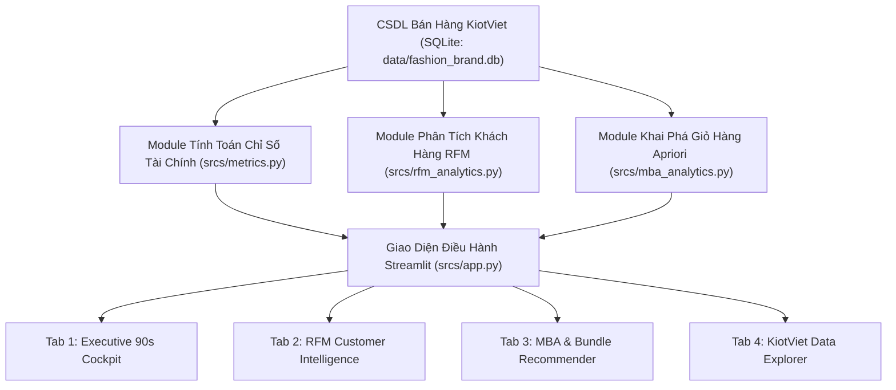
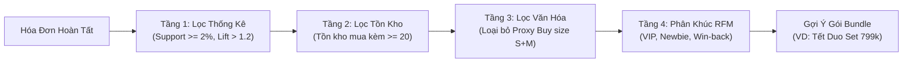

# TÀI LIỆU HƯỚNG DẪN SỬ DỤNG PHẦN MỀM (USER GUIDE)
## HỆ THỐNG PHÂN TÍCH KINH DOANH THỜI TRANG THÔNG MINH - FORM STUDIO
**Smart Fashion Executive Dashboard & Business Analytics System**

* **Mã tài liệu:** `DOC-UG-01`
* **Phiên bản:** `1.0.0`
* **Ngày phát hành:** 16/10/2026
* **Đối tượng sử dụng:** 
  1. **Founder & CEO Minh:** Ra quyết định điều hành nhanh trong 90 giây, giải phóng vốn lưu động.
  2. **Học sinh Lớp 11 (Chương trình Đào tạo BA & Vibe Coding):** Khảo sát cấu trúc hệ thống, hiểu bản chất chỉ số tài chính, quy luật giỏ hàng và vận hành ứng dụng Streamlit trong thực tế.

---

## MỤC LỤC
1. [TỔNG QUAN HỆ THỐNG VÀ KIẾN TRÚC DỰ ÁN](#1-tổng-quan-hệ-thống-và-kiến-trúc-dự-án)
2. [HƯỚNG DẪN KHỞI ĐỘNG VÀ DỪNG PHẦN MỀM (START / STOP GUIDE)](#2-hướng-dẫn-khởi-động-và-dừng-phần-mềm-start--stop-guide)
   - [2.1. Yêu cầu môi trường kỹ thuật](#21-yêu-cầu-môi-trường-kỹ-thuật)
   - [2.2. Khởi tạo & Cập nhật CSDL giả lập SDV](#22-khởi-tạo--cập-nhật-csdl-giả-lập-sdv)
   - [2.3. Khởi động ứng dụng Streamlit (Start)](#23-khởi-động-ứng-dụng-streamlit-start)
   - [2.4. Dừng phần mềm (Stop)](#24-dừng-phần-mềm-stop)
3. [HƯỚNG DẪN ĐỌC & PHÂN TÍCH THÔNG TIN TRÊN DASHBOARD](#3-hướng-dẫn-đọc--phân-tích-thông-tin-trên-dashboard)
   - [3.1. Thanh điều khiển bên trái (Sidebar Controls)](#31-thanh-điều-khiển-bên-trái-sidebar-controls)
   - [3.2. Tab 1: Bảng Điều Hành 90 Giây (Executive 90s Cockpit - SF-02)](#32-tab-1-bảng-điều-hành-90-giây-executive-90s-cockpit---sf-02)
   - [3.3. Tab 2: Trí Tuệ Khách Hàng RFM (Customer Intelligence - SF-03)](#33-tab-2-trí-tuệ-khách-hàng-rfm-customer-intelligence---sf-03)
   - [3.4. Tab 3: Khám Phá Giỏ Hàng & Gợi Ý Bundle (Apriori MBA - SF-04)](#34-tab-3-khám-phá-giỏ-hàng--gợi-ý-bundle-apriori-mba---sf-04)
   - [3.5. Tab 4: Tra Cứu CSDL Chuẩn Hóa KiotViet (Data Explorer)](#35-tab-4-tra-cứu-csdl-chuẩn-hóa-kiotviet-data-explorer)
4. [CẨM NANG XỬ LÝ SỰ CỐ (TROUBLESHOOTING & FAQ)](#4-cẩm-nang-xử-lý-sự-cố-troubleshooting--faq)

---

## 1. TỔNG QUAN HỆ THỐNG VÀ KIẾN TRÚC DỰ ÁN

Hệ thống Dashboard Phân tích Kinh doanh Thời trang Thông minh FORM Studio được phát triển nhằm giải quyết triệt để 3 điểm đau cốt tử của Founder Minh:
1. **Ảo tưởng doanh thu GMV:** Bán nhiều trên TikTok Shop nhưng lợi nhuận thực tế bị bào mòn bởi tỷ lệ hoàn hàng (~17-24%) và chi phí vận chuyển 2 chiều.
2. **Đứt gãy liên lạc với khách hàng VIP:** Mô hình bán hàng theo đợt (Drop) khiến việc xếp hạng RFM truyền thống bị sai lệch, thiếu cơ chế cấp mã ưu tiên (Early Access) cho khách ruột.
3. **Ứ đọng vốn lưu động:** 200 chiếc mũ Beanie vụ đông cũ đọng trong kho làm đóng băng 22 triệu đồng tiền mặt, chưa có gói bán chéo (Cross-sell Bundle) để xả hàng.



### Cấu Trúc Thư Mục Dự Án
* `docs/`: Chứa toàn bộ tài liệu khảo sát, BRD, SRS, SAD và Hướng dẫn sử dụng.
  - [`01_Khao_sat_Hien_trang_Form_Studio.md`](file:///c:/Users/Admin/Workspaces/gsj-localbrand-src/docs/01_Khao_sat_Hien_trang_Form_Studio.md): Khảo sát hiện trạng & điểm đau.
  - [`02_Tai_lieu_Yeu_cau_Nghiep_vu_BRD.md`](file:///c:/Users/Admin/Workspaces/gsj-localbrand-src/docs/02_Tai_lieu_Yeu_cau_Nghiep_vu_BRD.md): Yêu cầu nghiệp vụ.
  - [`03_Dac_ta_Yeu_cau_Phan_mem_SRS.md`](file:///c:/Users/Admin/Workspaces/gsj-localbrand-src/docs/03_Dac_ta_Yeu_cau_Phan_mem_SRS.md): Đặc tả chức năng SF-01 đến SF-05.
  - [`04_Thiet_ke_Co_so_Du_lieu_KiotViet_SAD.md`](file:///c:/Users/Admin/Workspaces/gsj-localbrand-src/docs/04_Thiet_ke_Co_so_Du_lieu_KiotViet_SAD.md): Thiết kế CSDL tương thích 100% KiotViet.
  - [`05_Huong_dan_Su_dung_Phan_mem_User_Guide.md`](file:///c:/Users/Admin/Workspaces/gsj-localbrand-src/docs/05_Huong_dan_Su_dung_Phan_mem_User_Guide.md): Tài liệu hướng dẫn sử dụng này.
* `srcs/`: Chứa toàn bộ mã nguồn chương trình Python:
  - [`app.py`](file:///c:/Users/Admin/Workspaces/gsj-localbrand-src/srcs/app.py): Ứng dụng Streamlit Dashboard chính.
  - [`metrics.py`](file:///c:/Users/Admin/Workspaces/gsj-localbrand-src/srcs/metrics.py): Module tính Unit Economics, CCR narrative, Cash Gap, tồn kho.
  - [`rfm_analytics.py`](file:///c:/Users/Admin/Workspaces/gsj-localbrand-src/srcs/rfm_analytics.py): Phân khúc RFM thích ứng Drop và thuật toán Săn Reseller.
  - [`mba_analytics.py`](file:///c:/Users/Admin/Workspaces/gsj-localbrand-src/srcs/mba_analytics.py): Thuật toán Apriori, Ma trận 4 tầng lọc, Mô phỏng xả mũ Beanie.
  - [`generate_synthetic_data_sdv.py`](file:///c:/Users/Admin/Workspaces/gsj-localbrand-src/srcs/generate_synthetic_data_sdv.py): Pipeline sinh dữ liệu giả lập SDV.
  - [`db_schema.sql`](file:///c:/Users/Admin/Workspaces/gsj-localbrand-src/srcs/db_schema.sql): DDL khởi tạo bảng SQLite.
* `data/`: Nơi lưu trữ cơ sở dữ liệu và tệp trích xuất:
  - `data/fashion_brand.db`: Cơ sở dữ liệu SQLite chuẩn.
  - `data/KiotViet_FORM_Studio_Export.xlsx`: File Excel trích xuất tương thích mẫu KiotViet.

---

## 2. HƯỚNG DẪN KHỞI ĐỘNG VÀ DỪNG PHẦN MỀM (START / STOP GUIDE)

### 2.1. Yêu Cầu Môi Trường Kỹ Thuật
* **Hệ điều hành:** Windows 10/11, macOS, hoặc Linux.
* **Môi trường:** Python 3.10 trở lên.
* **Các thư viện chính:** `streamlit`, `pandas`, `plotly`, `numpy`, `sdv`, `openpyxl`.

> [!TIP]
> Bạn có thể kiểm tra môi trường bằng lệnh sau trên terminal PowerShell:
> ```powershell
> python --version
> pip list | findstr "streamlit pandas plotly"
> ```

---

### 2.2. Khởi Tạo & Cập Nhật CSDL Giả Lập SDV
Trước khi chạy Dashboard lần đầu hoặc khi muốn làm mới toàn bộ 500 đơn hàng, 412 hóa đơn theo đúng các ràng buộc KiotViet (Rules R1 - R4), hãy thực hiện:

```powershell
python srcs/generate_synthetic_data_sdv.py
```

*Quá trình này chỉ mất khoảng 15-20 giây. Hệ thống sẽ tự động tạo file SQLite `data/fashion_brand.db` và xuất file Excel `data/KiotViet_FORM_Studio_Export.xlsx`.*

---

### 2.3. Khởi Động Nhanh Bằng Script Tiện Ích Trên Windows (Khuyên Dùng)

Nhằm giúp Founder Minh và các bạn học sinh vận hành phần mềm dễ dàng nhất, hệ thống đã trang bị sẵn bộ công cụ tiện ích 1-Click:

1. **Khởi động 1-Click (`start_app.bat`):**
   * Chỉ cần nhấp đúp chuột (Double-click) vào file [`start_app.bat`](file:///c:/Users/Admin/Workspaces/gsj-localbrand-src/start_app.bat) trong thư mục gốc.
   * Hệ thống sẽ tự động bật máy chủ Streamlit và mở ngay trình duyệt tại `http://localhost:8501`.

2. **Dừng phần mềm 1-Click (`stop_app.bat`):**
   * Khi muốn tắt máy chủ hoặc giải phóng cổng 8501, chỉ cần nhấp đúp chuột vào file [`stop_app.bat`](file:///c:/Users/Admin/Workspaces/gsj-localbrand-src/stop_app.bat).
   * Toàn bộ tiến trình liên quan sẽ được đóng an toàn.

3. **Menu Quản trị Đa Năng (`manage_app.ps1`):**
   * Mở PowerShell tại thư mục dự án và gõ:
     ```powershell
     .\manage_app.ps1
     ```
   * Hệ thống sẽ hiển thị bảng menu trực quan:
     * `[1] Start Dashboard` (Bật ứng dụng)
     * `[2] Stop Dashboard` (Tắt ứng dụng)
     * `[3] Restart Dashboard` (Khởi động lại)
     * `[4] Check Status` (Kiểm tra trạng thái & Health Check 200 OK)
     * `[5] Run SDV Generator` (Tái tạo CSDL KiotViet)
   * Hoặc truyền trực tiếp tham số:
     ```powershell
     .\manage_app.ps1 -Action start    # Bật ứng dụng
     .\manage_app.ps1 -Action stop     # Tắt ứng dụng
     .\manage_app.ps1 -Action status   # Kiểm tra trạng thái
     .\manage_app.ps1 -Action restart  # Khởi động lại
     .\manage_app.ps1 -Action sdv      # Tái tạo dữ liệu giả lập
     ```

---

### 2.4. Khởi Động & Dừng Thủ Công Qua Lệnh Terminal

#### A. Khởi động thủ công (Manual Start):
```powershell
streamlit run srcs/app.py
```
Hoặc chạy chế độ nền:
```powershell
streamlit run srcs/app.py --server.headless true --server.port 8501
```

#### B. Dừng thủ công (Manual Stop):
* Nhấn **`Ctrl + C`** trên cửa sổ Terminal đang chạy.
* Hoặc tắt bằng lệnh PowerShell:
  ```powershell
  Get-Process | Where-Object { $_.ProcessName -like "*streamlit*" } | Stop-Process -Force
  ```


---

## 3. HƯỚNG DẪN ĐỌC & PHÂN TÍCH THÔNG TIN TRÊN DASHBOARD

Giao diện Dashboard được thiết kế theo phong cách tối ưu hóa quyết định (Executive Cockpit) với tông màu Streetwear hiện đại (Dark Mode), gồm **Thanh công cụ bên trái (Sidebar)** và **4 Tab chức năng chuyên sâu**.

---

### 3.1. Thanh Điều Khiển Bên Trái (Sidebar Controls)

Thanh công cụ bên trái giúp người dùng lọc dữ liệu và thực hiện các phân tích độ nhạy (What-If Analysis):

1. **Kênh phân phối (Sales Channel):**
   * Cho phép chọn xem dữ liệu của: *Tất cả*, *TikTok Shop*, *Shopee*, *Cửa hàng Offline*, hoặc *Instagram*.
   * *Ý nghĩa quản trị:* So sánh hiệu quả tài chính giữa kênh bán Offline trực tiếp và kênh Online TMĐT.
2. **Bộ mô phỏng Unit Economics (Độ nhạy chi phí):**
   * **Phí sàn TMĐT (%):** Mặc định 7.0% (có thể trượt từ 3% - 12%).
   * **Hoa hồng KOC / KOL (%):** Mặc định 18.0% (có thể trượt từ 5% - 25%).
   * **Phí ship đơn hoàn (VNĐ):** Mặc định 30,000 đ/đơn hoàn (chi phí vận chuyển 2 chiều nhà bán hàng phải gánh).
   * *Ý nghĩa quản trị:* Giúp Founder Minh nhìn thấy ngay tác động khi sàn tăng phí hoặc khi thuê KOC hoa hồng cao.

---

### 3.2. Tab 1: Bảng Điều Hành 90 Giây (Executive 90s Cockpit - SF-02)

Được thiết kế theo **Quy tắc 90 Giây**: Chủ doanh nghiệp chỉ cần nhìn lướt trong 1.5 phút là nắm trọn sức khỏe tài chính và rủi ro vận hành.

#### A. Bộ 3 Thẻ Chỉ Số Sống Còn (The Survival Trio)
* **💵 Doanh Thu Thực Nhận (Net Revenue):** 
  * Là số tiền thực tế đổ vào tài khoản sau khi đã trừ đi các đơn bị hoàn/hủy.
  * *Chỉ số đối chiếu:* GMV (Gross Merchandise Value) và Thất thoát do hoàn hàng (Cash Gap).
* **🔄 Tỷ Lệ Hoàn Hàng (Return Rate):** 
  * Tỷ lệ đơn hàng bị hoàn trả trên tổng số đơn bán ra.
  * *Hệ thống cảnh báo màu:* 
    * 🟢 **Xanh lá (< 10%):** Vùng an toàn tuyệt đối.
    * 🟡 **Vàng (10% - 15%):** Vùng chú ý, cần kiểm tra bảng kích cỡ (size chart).
    * 🔴 **Đỏ (> 15%):** Báo động đỏ! Tỷ lệ hoàn đe dọa trực tiếp đến dòng tiền.
* **📈 Biên Lợi Nhuận Ròng (Net Margin %):**
  * Tỷ lệ phần trăm tiền lời ròng thu về sau khi đã trừ toàn bộ Giá vốn hàng bán (COGS), Phí sàn, Hoa hồng KOC và Phí ship hàng hoàn.

#### B. Bản Tóm Tắt Tự Động (AI-Driven CCR Narrative)
Khung văn bản ngôn ngữ tự nhiên tự động phiên dịch các con số phức tạp thành câu chuyện kinh doanh:
* Phân tích rõ vì sao GMV đạt cao nhưng lợi nhuận thực nhận lại thấp.
* Chỉ đích danh kênh bán hàng gây thất thoát lớn nhất (thường là TikTok Shop do văn hóa chốt đơn bốc đồng trên Livestream).
* Đưa ra khuyến nghị hành động tức thì cho ngày làm việc.

#### C. Biểu Đồ Thất Thoát Dòng Tiền & Cảnh Báo Tồn Kho
* **Biểu đồ Dòng tiền (GMV vs Net Revenue vs Return Loss):** Cho thấy khoảng cách thất thoát (Cash Gap) qua từng mốc thời gian (các đợt Drop và Flash Sale 11.11).
* **Phễu Chuyển Đổi Đơn Hàng (Order Conversion Funnel):** Minh họa tỷ lệ chuyển đổi từ lúc khách Đặt hàng (500 đơn) $\rightarrow$ Xuất hóa đơn (412 đơn) $\rightarrow$ Giao thành công / Bị hủy / Hoàn trả.
* **Bảng Cảnh Báo Điểm Tái Đặt Hàng (ROP - Reorder Point Alert):**
  $$\text{ROP} = (\text{Số lượng bán trung bình ngày} \times \text{Thời gian nhập hàng - Lead Time}) + \text{Tồn kho an toàn}$$
  * Giúp Founder Minh biết sản phẩm nào sắp cháy hàng (cần sản xuất gấp) và sản phẩm nào đang ế ẩm (cần giải phóng).

---

### 3.3. Tab 2: Trí Tuệ Khách Hàng RFM (Customer Intelligence - SF-03)

Ứng dụng mô hình RFM được tinh chỉnh riêng cho văn hóa săn đồ thời trang Local Brand (Drop Model).

#### A. 5 Phân Khúc Khách Hàng Chiến Lược
1. **🏆 Khách Hàng VIP / Champions:** Khách ruột, mua liên tục trong các đợt Drop, giá trị chi tiêu cực cao.
   * *Hành động đề xuất:* Tặng Secret Passcode mua sớm 30 phút (Early Access).
2. **💎 Khách Hàng Thân Thiết (Loyal Customers):** Mua hàng đều đặn, phản hồi tốt.
   * *Hành động đề xuất:* Mời tham gia khảo sát mẫu thiết kế vụ tới, tặng voucher nâng cấp đơn.
3. **🌱 Khách Hàng Tiềm Năng (Potential / Promising):** Khách mới mua 1-2 lần gần đây với giá trị đơn lớn.
   * *Hành động đề xuất:* Gợi ý các sản phẩm mang tính biểu tượng (Hero Products) và phụ kiện đi kèm.
4. **⚠️ Khách Có Nguy Cơ Rời Bỏ (At-Risk):** Từng mua rất nhiều trong quá khứ nhưng đã bỏ lỡ 2 đợt Drop gần nhất.
   * *Hành động đề xuất:* Gửi tin nhắn Zalo ZNS kèm mã giảm giá đặc biệt để lôi kéo quay lại.
5. **💤 Khách Đã Ngủ Đông (Lost / Hibernating):** Rất lâu không quay lại mua sắm.

#### B. Thuật Toán Săn Reseller / Gom Hàng (Reseller Hunter)
* **Nguyên lý:** Khách hàng thời trang cá nhân thường chỉ mua 1 chiếc/size để mặc. Nếu một khách hàng có số lượng mua trung bình trên mỗi đơn $> 3$ chiếc hoặc chi tiêu đột biến trong các đợt mở bán, thuật toán sẽ gắn cờ cảnh báo **`🚨 Nghi vấn Reseller / Gom hàng`**.
* **Ý nghĩa:** Bảo vệ quyền lợi của cộng đồng fan chân chính, ngăn chặn tình trạng ôm hàng bán lại giá chợ đen gây bức xúc cho khách hàng trẻ.

#### C. Chiến Dịch Danh Sách 200 Khách Hàng VIP Early Access
* Lọc chính xác 200 khách hàng trung thành nhất theo điểm phân vị RFM.
* Nút bấm **`📥 Xuất 200 VIP Early Access (Excel/CSV)`** tạo ngay file danh sách kèm số điện thoại đã mã hóa bảo mật để bộ phận Marketing gửi tin nhắn SMS / Zalo phát mã mua sớm.

---

### 3.4. Tab 3: Khám Phá Giỏ Hàng & Gợi Ý Bundle (Apriori MBA - SF-04)

Giúp tăng giá trị đơn hàng trung bình (AOV) và giải phóng hàng tồn kho thông qua thuật toán khai phá quy luật giỏ hàng (Market Basket Analysis).



#### A. Cách Hiểu 3 Chỉ Số Cốt Lõi Của Thuật Toán Apriori
* **Support (Tần suất xuất hiện):** Tỷ lệ các đơn hàng có chứa đồng thời cả 2 sản phẩm trên toàn bộ hệ thống. (Ví dụ: Support = 10% nghĩa là cứ 100 đơn hàng thì có 10 đơn mua cả Áo Hoodie và Mũ Beanie).
* **Confidence (Độ tin cậy):** Xác suất một khách hàng sau khi đã chọn mua sản phẩm $A$ sẽ quyết định mua thêm sản phẩm $B$. (Ví dụ: Confidence = 60% nghĩa là trong 100 người mua Áo Hoodie, có 60 người sẵn sàng mua thêm Mũ Beanie).
* **Lift (Hệ số ái lực):** Đo lường mức độ mua kèm có thực sự xuất phát từ nhu cầu tự nhiên hay chỉ là ngẫu nhiên:
  * $\text{Lift} = 1$: Hai sản phẩm hoàn toàn độc lập, mua kèm chỉ do tình cờ.
  * $\text{Lift} > 1$: Hai sản phẩm có lực hút lẫn nhau (Ái lực tích cực). Lift càng cao, nhu cầu mua cùng càng mạnh mẽ!
  * $\text{Lift} < 1$: Hai sản phẩm mang tính thay thế, triệt tiêu lẫn nhau (khách mua cái này thì không mua cái kia).

#### B. Ma Trận 4 Tầng Lọc Độc Quyền Của FORM Studio
1. **Lọc Thống Kê:** Chỉ giữ lại các combo có dữ liệu chứng minh vững chắc.
2. **Lọc Tồn Kho (Consequent Stock $\ge 20$):** Nếu sản phẩm mua kèm trong kho chỉ còn dưới 20 cái, hệ thống tự động ẩn gợi ý để tránh tình trạng khách ồ ạt đặt mua nhưng không có hàng giao.
3. **Lọc Văn Hóa Streetwear (Loại Proxy Buy):** Trong văn hóa Streetwear, nhiều bạn trẻ mua hộ bạn bè hoặc mua tặng người yêu (dẫn đến hóa đơn có 2 chiếc Hoodie size S và size L). Đây không phải là một bộ trang phục (Outfit). Thuật toán tự động nhận diện và loại bỏ để chỉ giữ lại các outfit phối đồ chuẩn: *Áo Hoodie + Mũ Beanie*, *Áo Phông + Quần Cargo*, *Áo Bomber + Mũ Lưỡi Trai*.
4. **Lọc Phân Khúc RFM:** Gợi ý đúng gói combo cho đúng đối tượng khách hàng (Combo cao cấp gửi cho VIP, Combo cơ bản gửi cho khách mới).

#### C. Simulator Định Giá Bundle: Chiến Dịch Giải Cứu 200 Mũ Beanie Tồn Kho
* **Vấn đề của Founder Minh:** 200 chiếc mũ `BEANIE-001` tồn kho vụ cũ chiếm dụng **22.000.000 đ** tiền vốn.
* **Phát hiện từ dữ liệu:** Khách mua Áo Hoodie có tới **~59% xác suất mua kèm Mũ Beanie (Lift = 1.95x - 2.10x)**.
* **Thanh trượt định giá mô phỏng (Simulator):**
  * Người dùng có thể kéo thanh trượt từ 699,000 đ đến 850,000 đ để quan sát thời gian thực:
    * Mức tăng trưởng AOV (AOV Uplift).
    * Tổng số tiền mặt vốn lưu động được giải phóng (22 triệu đồng).
    * Lợi nhuận gộp đóng góp của chiến dịch (đạt trên 81 triệu đồng với mức giá 799k).

---

### 3.5. Tab 4: Tra Cứu CSDL Chuẩn Hóa KiotViet (Data Explorer)

Dành cho bộ phận Kế toán và Quản trị hệ thống tra cứu đối soát nhanh dữ liệu gốc theo đúng chuẩn xuất nhập KiotViet:
* **Đơn Đặt Hàng (FACT_ORDERS):** Tra cứu mã đơn `DHxxxxx`, thời gian đặt, kênh bán, trạng thái đơn và nhân viên phụ trách.
* **Hóa Đơn Bán Hàng (FACT_INVOICES):** Tra cứu mã hóa đơn tiền tố chuẩn `HDIPxxxxx`, chi tiết phương thức thanh toán (Tiền mặt, Thẻ, Chuyển khoản) và trạng thái hoàn hàng.
* **Danh Mục Sản Phẩm (DIM_PRODUCTS):** Kiểm tra 12 SKU chủ lực, giá vốn, giá niêm yết và số lượng tồn kho thực tế.
* **Danh Mục Khách Hàng (DIM_CUSTOMERS):** Tra cứu hồ sơ khách hàng, khu vực địa lý, doanh số tích lũy và công nợ.

---

## 4. CẨM NANG XỬ LÝ SỰ CỐ (TROUBLESHOOTING & FAQ)

### Q1: Khi chạy lệnh `streamlit run srcs/app.py`, màn hình báo lỗi `Port 8501 is already in use`?
* **Nguyên nhân:** Cổng mạng 8501 đang bị chiếm giữ bởi một phiên bản Dashboard chạy trước đó.
* **Cách khắc phục:**
  1. Cách 1: Chỉ định cổng mới: `streamlit run srcs/app.py --server.port 8502`.
  2. Cách 2: Tắt tiến trình cũ bằng lệnh PowerShell:
     ```powershell
     Get-NetTCPConnection -LocalPort 8501 | Select-Object OwningProcess
     Stop-Process -Id <MÃ_PID> -Force
     ```

---

### Q2: Chữ tiếng Việt trên màn hình console PowerShell bị hiển thị sai ký tự (lỗi Unicode / charmap)?
* **Nguyên nhân:** Console Windows mặc định sử dụng trang mã `cp1252` hoặc `cp437`.
* **Cách khắc phục:** Chạy lệnh chuyển đổi trang mã console sang UTF-8 trước khi chạy Python:
  ```powershell
  chcp 65001
  $env:PYTHONIOENCODING="utf-8"
  ```
  *(Toàn bộ mã nguồn `srcs/app.py` và `srcs/generate_synthetic_data_sdv.py` đều đã được tích hợp sẵn lệnh tự động kích hoạt `sys.stdout.reconfigure(encoding='utf-8')`).*

---

### Q3: Khi chỉnh sửa mã nguồn, tôi có cần phải tắt phần mềm đi rồi bật lại không?
* **Trả lời:** Không cần thiết! Streamlit sở hữu cơ chế **Hot Reloading**. Khi bạn lưu file mã nguồn (`Ctrl + S`), hãy nhìn lên góc trên bên phải màn hình trình duyệt:
  * Nhấn nút **`Rerun`** (hoặc chọn **`Always rerun`**) để dashboard tự động cập nhật ngay lập tức các thay đổi.

---

### Q4: Muốn xuất dữ liệu danh sách khách hàng VIP hoặc Bundle ra Excel thì làm như thế nào?
* **Trả lời:**
  * Tại **Tab 2 (RFM)**: Cuộn xuống mục Danh sách 200 VIP và bấm nút **`📥 Tải Danh Sách 200 VIP Early Access (CSV)`**.
  * Tại **Tab 3 (MBA)**: Cuộn xuống bảng luật kết hợp và bấm nút **`📥 Xuất Danh Sách Bundle Sang KiotViet & TikTok Shop (CSV)`**.
  * Dữ liệu xuất ra sử dụng chuẩn UTF-8 kèm BOM, mở trực tiếp trên Microsoft Excel tiếng Việt không bị lỗi font chữ.

---

> [!NOTE]
> **Kênh hỗ trợ học tập & vận hành:**
> * Giảng viên phụ trách môn học: Bộ môn Phân tích Dữ liệu Kinh doanh (Business Analytics)
> * Cố vấn kỹ thuật: Trợ lý Antigravity AI Pair Programming
> * Email hỗ trợ: `support@formstudio.localbrand.vn`
